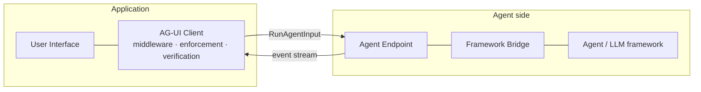
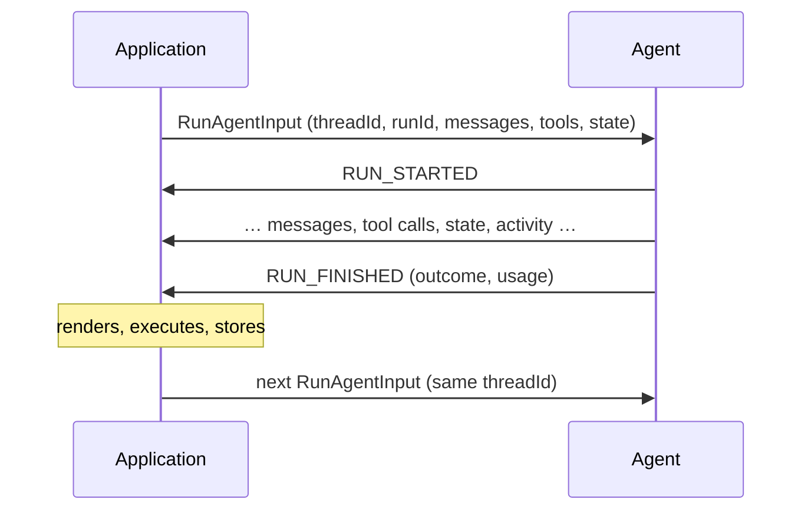

<em class="lead">组件、作为交互单位的运行，以及两者背后的原则</em>

AG-UI 通过一条通道将智能体连接到面向用户的应用：一条有序的类型化事件流，
对一个请求作出应答。用户从智能体看到的一切——文本、工具调用、推理、状态、
进度——都在事件流中；不存在旁路通道。

## 核心组件 {#core-components}

### 应用 {#the-application}

拥有用户。它渲染事件流，执行它自己声明过的
[工具调用](events/tool-calls.md)，保存智能体与它共享的
[状态](events/state.md)，并决定什么需要用户同意。

### 客户端 {#the-client}

消费方的协议机构，通常是一个 SDK。它发送[运行输入](basic/run-input.md)，
对返回的内容运行[处理流水线](basic/processing.md)——兼容性翻译、中间件、
强制执行、块展开、验证——然后交给应用一条可以信任的事件流。

### 智能体端点及其桥接器 {#the-agent-endpoint-and-its-bridge}

生产方。桥接器将一个框架的原生事件翻译为协议事件；端点说一种
[传输绑定](basic/transports/index.md)。协议不携带任何框架概念，
这正是让一个客户端可以面对任何框架的原因。

### 中间件 {#middleware}

任一侧的代码都可以安装到客户端的流水线中。它在强制执行剥离任何东西
**之前**看到每个事件，因此一个兼容性垫片可以翻译一个
[被弃用的形状](basic/versioning.md#retired-shapes)，一个扩展可以
对当前版本未定义的材料采取行动。

## 运行 {#the-run}

交互的单位。消费方用一个 `RunAgentInput` 开启一次交换；生产方用
[运行生命周期](events/lifecycle.md) 所界定的事件作出应答——被请求的
运行，其前可能还有重放的会话历史；对话是这样一串运行的线程，
累积着消息和状态。

## 设计原则 {#design-principles}

1. **智能体应当极其容易暴露。** 桥接器是一次翻译，而不是一次实现：
   框架发出的任何东西都映射到一小组事件族，且所有可选项都是可选的。
   强制性的面就是运行生命周期，别无其他。

2. **一切可观察的东西都在交换中。** 关于智能体可见行为的任何内容都不走
   带外：持有这些交换——每个运行输入以及应答它的事件——的记录器可以
   重建 UI 在每个时刻所知道的内容，这正是协议可测试、可重放、
   与传输无关的原因。

3. **宽容的读取方，严格的写入方。** 生产方 MUST 只发出模式所定义的内容；
   消费方 MUST 存活于它不认识的内容，剥离它并发出警告，而不是失败。
   完整的不对称性——以及为什么畸形的已知值被反向处理——即
   [处理模型](basic/processing.md)。

4. **中间件先于强制执行运行。** 在任何东西被剥离之前，翻译都有它的机会，
   于是协议可以在不使任何一方落下的情况下演进：昨天的形状在边界处
   被翻译，明天的穿过直通到认识它们的一方。

5. **传输是绑定。** 语义绝不由线路改变。同样的事件、同样的规则，
   无论被封装为 SSE 文本还是 protobuf 帧——并以共享字节语料固定
   跨实现的等价性。
