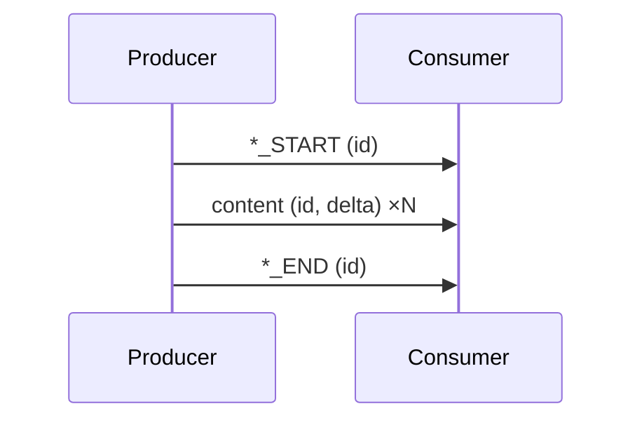
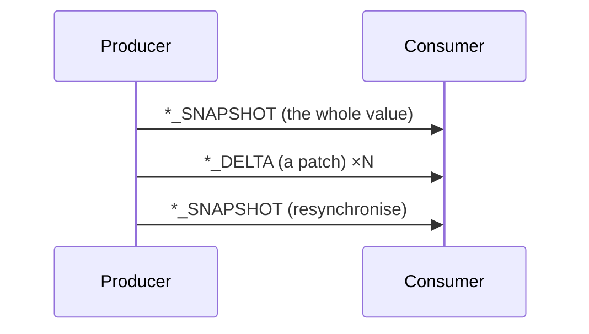
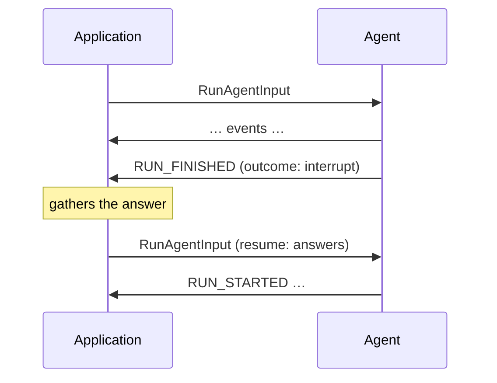

<em class="lead">生产方把事件组合成事件流的方式</em>

本页定义核心协议的事件模式：生产方把事件组合成事件流的方式。每一种
[传输](../../basic/transports/index.md) 都承载所有这些模式；传输之间的区别仅在于
事件如何封装和投递。

协议的方向是固定的。事件从生产方流向消费方；消费方在每次交换中恰好发言一次，
通过发送开启运行的[运行输入](../../basic/run-input.md)。生产方 MUST NOT
要求消费方在运行中途发送任何消息 — 需要外部输入的运行会结束，答案在下次
运行中到达：通过中断及其恢复条目，或通过一个遗留未答、在下次输入的消息中
作答的[前端工具调用](../../events/tool-calls.md#frontend-tools)。

## 流式传输 {#streaming}

长值分批到达：`*_START` 开启一个条目，内容事件扩展它，`*_END` 关闭它 —
或者分块简写把这三步压缩在一起。文本消息、工具调用和推理消息都以这种方式
流式传输。

参见 [流式消息](../../basic/patterns/streaming.md)。

## 快照与增量 {#snapshot-and-delta}

不断演化的值 — 智能体状态、活动、会话本身 — 以快照（替换）与增量（修订）
承载，增量以 RFC 6902 JSON Patch 表达。

参见 [快照与增量](../../basic/patterns/snapshots.md)。

## 中断与恢复 {#interrupt-and-resume}

需要外部提供某物 — 一项审批、一个缺失的值 — 的运行以中断结果结束，而从它
继续的运行在其输入中携带答案。

参见 [中断与恢复](../../basic/patterns/interrupt-resume.md)。

## 新增模式 {#adding-patterns}

所有协议特性都由这些模式构建。新增模式的协议修订版在本页定义该模式。传输
无需改动即可承载新模式，因为模式完全以事件和运行输入表达。
