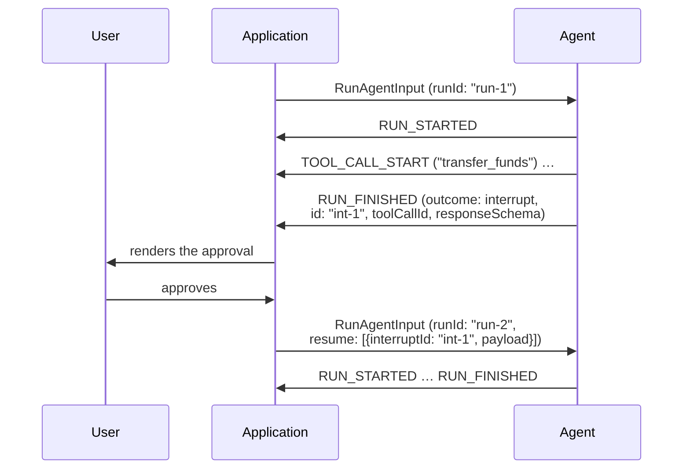

<em class="lead">运行如何向外部索取某物，以及下一次运行如何作答</em>

运行有时需要只有外部世界才能给予它的东西 — 一项审批、一项凭据、一个选择。
协议没有来自消费方的运行中途通道，所以运行不会等待：它结束，并说明自己在
等什么；而从它继续的运行携带答案。

## 中断 {#interrupting}

需要外部输入的运行以 `RUN_FINISHED` 结束，其 `outcome` 为中断结果，携带一个
或多个 `Interrupt` 对象 — 至少一个，因为一个没有任何可回答内容的中断结果
会让消费方无事可做。

- 生产方 MUST NOT 把一个被中断的运行报告为成功：中断结果是结束一个停下来
  *询问*的运行的唯一符合性方式 — 生产方指明自己在等什么，恢复条目对之作答。
  通过调用[前端工具](../../events/tool-calls.md#frontend-tools)而停止的运行
  是另一条普通路径：它以成功结束，在成功结果的 `pendingToolCallIds` 中指明
  未答的调用，答案搭载在下次输入的消息中。因为*被要求*而停止的运行两者都
  不是：它以[取消结果](../../events/lifecycle.md#cancelled-runs)结束，
  什么都不索取。
- 每个中断的 `id` MUST 在运行内唯一；恢复条目凭此 id 对它作答。
- 中断的 `reason` 是开放字符串 — 协议不试图对智能体可能需要输入的各种原因
  进行分类。`message` 是面向作答者的可读提示；`toolCallId` 指明一项审批
  所针对的工具调用；`responseSchema` 描述答案的预期形状，以不透明方式携带，
  使消费方能为它构建表单。
- 在子智能体内部引发的中断 MAY 携带该子智能体的 `subagentRunId`；
  [子智能体规则](../../events/subagents.md)管辖其归属以及与之相伴的
  挂起结果。

被中断的运行是一个已关闭的运行。[运行生命周期](../../events/lifecycle.md)
对已关闭运行所说的一切均适用 — 包括它容忍的唯一一次迟到：一个报告在关闭
之后才浮现的失败的 `RUN_ERROR` — 而继续意味着一次新的运行。

## 恢复 {#resuming}

继续的运行把答案携带在输入的 `resume` 列表中，每回答一个中断对应一个
`ResumeEntry`：

- 每个条目的 `interruptId` MUST 指明被继续运行的一个中断 — 即该会话上最近
  一次被中断的运行。
- 条目的 `status` 说明该中断是被回答还是被放弃；`payload` 携带智能体所
  询问的答案，可为任意 JSON 值；`metadata` 是关于响应的信封信息，不是答案
  的一部分。
- `resume` 列表 MUST 覆盖被继续运行的每一个中断：每一个要么已被回答，要么
  由一个带放弃状态的条目明确放弃。遗漏不等于放弃。覆盖是*消费方*强制执行
  的规则：消费方持有被结束 `RUN_FINISHED` 送达的中断，并且由它组装
  `resume` 列表，所以它是唯一总能判断列表是否完整的参与者。消费方 MUST
  在运行开始之前 — 在任何东西发出之前 — 拒绝留下未覆盖中断的恢复输入，
  并且 MUST NOT 无声地越过一个它没有对应条目的中断。不要求生产方检查
  这一点，它无需保留被中断运行的任何东西即可符合；当一个有缺陷的消费方
  仍然发来一个不完整列表时它怎么做，是它的错误处理，见下文。一个被放弃的
  中断对智能体的工作意味着什么，是生产方自己的事。
- `expiresAt` 有意不限定格式，因此*是否*已过期由作出判定的消费方自行解读 —
  参考实现把它当作日期读取，把不晚于当前时间的视为已过期。规则附着于判定，
  而非附着于 Schema 拒绝去规定的解析：被消费方判定为已过期的中断不能再被
  *回答* — 消费方在运行开始之前拒绝为它作出解决的恢复条目，如同拒绝未覆盖
  的中断。它仍然可以 — 并且，由于覆盖是强制的，也必须 — 被放弃，会话正是
  借此越过一个没人及时作答的中断。
- 会话与状态的连续性横跨这段间隙保持：恢复运行携带相同的 `threadId`、累积
  的消息，以及被中断运行留下的状态，正如任何[顺序运行](../../events/lifecycle.md)
  一样。
- Token 用量不横跨间隙携带：恢复运行的 `usage` 只
  [涵盖](../../events/lifecycle.md#token-usage)它自己发起的模型调用。被
  中断的运行已经在使其中断的那个 `RUN_FINISHED` 上报告了自己的用量。

收到恢复条目的生产方把它们当作自己停下来等待的答案。该列表是消费方对已决
事项的完整陈述，生产方把它当作如此：它不被要求记住先前运行的中断，不被
要求把列表与它们比对，也不被要求为这个目的在运行之间保留任何状态。什么都
不横跨间隙携带的生产方是符合性的。

消费方规则的两种违规仍然可能到达生产方。以下是生产方对它们的错误处理，
而不是发送它们的许可。

- **未被识别的条目** — 指明一个生产方未曾引发的中断：运行 SHOULD
  忽略该条目继续，生产方 SHOULD 呈现一条警告，而不是因为一个它从未索取的
  答案让运行失败。

- **未被覆盖的中断** — 生产方能够察觉它仍处于打开状态且没有条目，因为它
  保留了被中断运行的检查点，或者因为消息携带了一个受审批约束的工具调用，
  既无结果也没有作答的条目。
  生产方 MUST NOT 仅凭条目的缺失去执行被中断的动作，并且 MUST NOT 把
  遗漏当作放弃 — 带着警告丢弃该调用并以成功结束，会让一个有缺陷的消费方
  放弃没人决定要放弃的东西，而这正是覆盖规则存在所要防止的结果。察觉之后，
  生产方保持该中断处于打开状态。它 MAY 在运行开始之前拒绝该输入，如同拒绝
  任何无效输入（以 `RUN_ERROR` 开启的流，或传输本身对请求的拒绝）；或者
  它 MAY 只运行被覆盖条目所允许的部分，再次以中断结果结束，携带仍然打开的
  中断，让消费方有再次作答的机会。无论哪种方式，当生产方知道某个中断仍
  处于打开状态却无人作答时，运行 MUST NOT 以成功结束。无法察觉的生产方 —
  即上文的无状态情况 — 在此不负任何义务，因为它没有什么可察觉的。

## 消息流 {#message-flow}

## 数据类型 {#data-types}

[`RunFinishedInterruptOutcome`](../../schema.md#runfinishedinterruptoutcome)、[`Interrupt`](../../schema.md#interrupt) 和 [`ResumeEntry`](../../schema.md#resumeentry) 由
[Schema 参考](../../schema.md)定义。`expiresAt` 存在时，约定上携带 ISO 8601
时间戳；Schema 有意不约束其格式。

## 错误处理 {#error-handling}

携带中断的成功结果是一个 Schema 已经拒绝的矛盾 — 成功结果是封闭的。对一个
不延续被中断运行的运行携带的 `resume` 列表不作答任何东西；生产方像上文
那样把它的条目当作未被识别处理。
