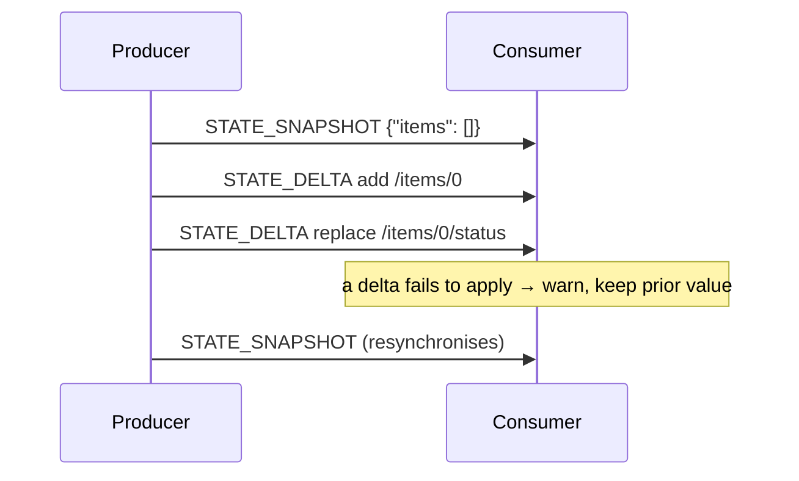

<em class="lead">演化的值如何传输：整体替换、以 JSON Patch 修订</em>

生产方报告的内容中，有些不是文本流，而是不断演化的值：智能体的状态、
活动的内容、会话本身。这些以**快照**（替换）和**增量**（修订）的形式传输。

三个家族使用该模式：[状态](../../events/state.md)（`STATE_SNAPSHOT`、
`STATE_DELTA`，以及用于会话的 `MESSAGES_SNAPSHOT`）和
[活动](../../events/activity.md)（`ACTIVITY_SNAPSHOT`、`ACTIVITY_DELTA`）。
本页说明它们的共同之处；各家族页面说明各自替换和修订的对象。

## 快照 {#snapshots}

快照携带完整的值。消费方 MUST 用快照内容替换自己的副本 — 快照不是合并 —
除非快照本身通过其家族定义的字段选择退出（唯一情况是
[活动](../../events/activity.md) 的 `replace: false`）。它之前的任何
增量都已作废：快照无论被应用还是被拒绝，都是新的基线时刻。

生产方 MAY 在任何时间发送快照，并且 SHOULD 在无法保证消费方的基线与自己的
基线一致时发送 — 在错误之后、在增量无法表达的内容之后、或在一个延续旧
会话的运行的开始。

## 增量 {#deltas}

增量修订当前值，表达为一个
[RFC 6902](https://datatracker.ietf.org/doc/html/rfc6902) JSON Patch：一个
按顺序、原子地应用的操作数组 — 任何一个操作失败，文档保持原样。

- 增量针对消费方的当前值应用：即最后一个快照被此后每一个增量修订之后的
  结果。对于状态，运行起始的值是输入的 `state`；输入
  [未携带时](../../basic/run-input.md#state)为空对象。
- 生产方 MUST NOT 为它没有给消费方提供基线的值发送增量。什么算作基线是
  各家族自己的事 — 状态从输入获得基线，活动只在第一个快照之后才有基线。
- Patch 操作是有意为之的开放对象：Schema 如此标注，RFC 6902 未定义的成员
  是协议上合法的材料，[处理模型](../../basic/processing.md) MUST NOT
  将其剥离。

## 当 Patch 无法应用时 {#when-a-patch-does-not-apply}

结构上有效并不意味着 Patch 能应用：一个格式正确的操作可能指向一个不存在
的路径，RFC 6902 把这一点留给应用方处理。格式错误的*操作* — 不是数组的
Patch、缺少必需成员或成员类型错误的操作 — 是格式错误的已知值，与其他
一切一样致命。`op` 指明 RFC 6902 未定义之物的操作不是格式错误，而是
不被识别 — 是本消费方发布之后才加入判别联合的成员 —
[处理模型](../../basic/processing.md)的列表规则适用：该元素在发出警告
之后从 Patch 中丢弃，运行继续存活。格式正确但应用失败的 Patch 又是另一种
情况：

- 消费方 MUST NOT 保留部分应用的结果 — RFC 6902 的应用是原子的。
- 消费方 MUST 呈现该失败 — 一条足以诊断的警告，指明失败的是什么、为何
  失败 — 并且 MAY 继续使用其先前的值，而不是让运行失败。
- 失败的 `test` 操作属于同一种情况：Patch 无法应用，消费方保留其先前的
  值。

从那一刻起，消费方的值可能与生产方的值发生了分歧。获知此事、或无法排除
此事的生产方 SHOULD 用快照重新同步；消费方 MUST 采用下一个快照，无论它
此前跳过了什么 — 这正是使恢复成为可能的原因。

## 消息流 {#message-flow}

## 数据类型 {#data-types}

Patch 的形状 — [`JsonPatch`](../../schema.md#jsonpatch)、它的操作、
[`JsonPointer`](../../schema.md#jsonpointer) — 由
[Schema 参考](../../schema.md)参照 RFC 6902 定义。
