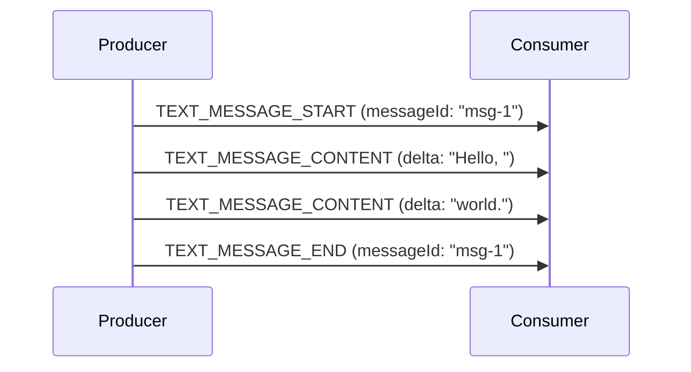
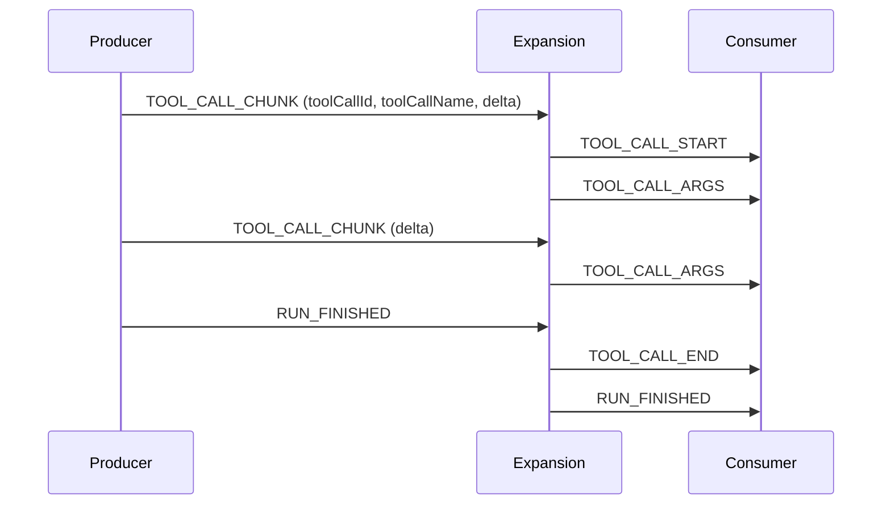

<em class="lead">开启–内容–关闭的纪律、分块形式，以及约束它们的规则</em>

三个事件家族以分批方式流式传输长值：文本消息、工具调用和推理消息。三者都遵循
同一个模式，该模式有两种写法 — 显式的 **开启–内容–关闭** 三元组，以及一种
紧凑的 **分块** 形式，供否则不得不做缓冲的生产方使用。本页只定义一次该模式；
各家族页面（[文本消息](../../events/text-messages.md)、
[工具调用](../../events/tool-calls.md)、[推理](../../events/reasoning.md)）
只补充各家族特有的内容。

## 开启、内容、关闭 {#open-content-close}

流式条目由其 `*_START` 事件开启，由零个或更多内容事件扩展，再由其 `*_END`
事件关闭，全部以条目的标识符匹配（消息用 `messageId`，工具调用用
`toolCallId`）。

- 生产方 MUST NOT 开启一个标识符已处于打开状态的条目。
- 生产方 MUST NOT 为未打开的标识符发送内容事件或结束事件。
- 生产方开启的每个条目 MUST 在运行结束之前关闭。

开启事件携带描述该条目的字段；内容事件只携带标识符和一个 `delta`。增量按
到达顺序拼接，构成条目的值。

## 交错 {#interleaving}

消息、工具调用、推理消息和步骤彼此独立。生产方 MAY 自由地交错它们 —
一条消息还在流式传输时，工具调用 MAY 开启 — 只要每个条目都遵守自己的
开启/关闭纪律。

独立事件（`STATE_SNAPSHOT`、`STATE_DELTA`、`MESSAGES_SNAPSHOT`、
`ACTIVITY_SNAPSHOT`、`ACTIVITY_DELTA`、`CUSTOM`、`RAW`、
`REASONING_ENCRYPTED_VALUE`）自身不开启也不关闭任何条目，MAY 出现在一个
打开运行内的任何位置。在分块形式中，其中一些确实会结束一个打开的分块流 —
到达本身即告诉消费方简写已无法继续 — 列表见
[关闭分块流](#closing-a-chunk-stream)。

## 分块形式 {#the-chunked-form}

`TEXT_MESSAGE_CHUNK`、`TOOL_CALL_CHUNK` 和 `REASONING_MESSAGE_CHUNK` 是
三元组的一种紧凑写法。消费方 MUST 在验证之前、在应用代码之前把它们展开为
start/content/end 形式，因此三元组的每一条规则都适用于展开后的事件。展开
相对于强制执行和中间件的位置在[处理模型](../../basic/processing.md)中
规定；在所有路径上都成立的不变式是：一个块按其本身作为事件来判定 — 无论
哪个阶段先遇到一个格式错误的块，都拒绝它而不是修复它。

两种写法不得在一个条目内混用。由块开启的条目以分块形式继续和关闭 — 其
`*_END` 是合成的，从不发送 — 由 `*_START` 开启的条目则显式地继续和关闭。
携带一个分块流正在组装的标识符的显式事件并不是该分块流的延续：它结束简写，
如[关闭分块流](#closing-a-chunk-stream)所述，其后的内容按三元组规则判定 —
这使得在一个条目内混用两种形式成为生产方 MUST NOT 发出的格式错误序列。

### 首个块 {#the-first-chunk}

条目的首个块携带开启它所需的内容；后续块 MAY 省略这些字段，并继续已经
打开的条目。

- 消息的首个 `TEXT_MESSAGE_CHUNK` MUST 携带 `messageId`。它 MAY 携带
  `role`；缺省的 `role` 表示 `assistant`，与 `TEXT_MESSAGE_START` 上
  完全一致。
- 消息的首个 `REASONING_MESSAGE_CHUNK` MUST 携带 `messageId`。
- 一次调用的首个 `TOOL_CALL_CHUNK` MUST 同时携带 `toolCallId` 和
  `toolCallName`。

消费方 MUST 把缺少必需字段的首个块当作协议违规，而不是编造一个标识符。

### 续块 {#continuation-chunks}

- 后续携带标识符的块 MUST 携带它所继续的同一个标识符。指明不同标识符的块
  开启一个新条目，而前一个条目先关闭。
- 续块 MAY 重复其开启者确立过的字段 — 文本消息上的 `role` 或 `name`、
  工具调用上的 `toolCallName` 或 `parentMessageId` — 但只能取相同的值。
  消费方 MUST 把冲突的重复当作协议违规。这包括与开启者通过省略确立的值
  相冲突的值：未带 `role` 开启的消息是 `assistant` 消息，之后声称另一个
  `role` 的块与之矛盾。

::::
冲突重复规则与[子智能体归属规则](../../events/subagents.md)对一个与其
  开启者就 `subagentRunId` 意见不一的延续所做的是同一种判定：生产方对
  同一个条目说了两件互不相容的事，在两者之间没有正确的选择方式。
::::

### 关闭分块流 {#closing-a-chunk-stream}

分块形式没有显式的结束事件，因此当流不再能继续时，由消费方合成 `*_END`：

- 当一个块在同一通道开启另一个条目时；
- 当一个消息、工具调用、步骤、状态、自定义或推理事件到达该条目的通道时 —
  有四个例外，它们游离于组装之外，不关闭任何东西：`RAW`、
  `ACTIVITY_SNAPSHOT`、`ACTIVITY_DELTA`、`REASONING_ENCRYPTED_VALUE`
  （以及 `SUBAGENT_STARTED`，它开启一条新通道，而不是触碰当前这条）；
- 当一个运行级事件到达时 — `RUN_STARTED`、`RUN_FINISHED`、`RUN_ERROR`
  或 `MESSAGES_SNAPSHOT` — 它关闭所有通道；或者当条目所归属的子智能体
  终止时，关闭该子智能体的通道。

一条简写延续属于哪个通道 — 父智能体的，还是某个子智能体的 — 由
[归属规则](../../events/subagents.md)决定；对于既不携带标识符也不携带
标记的延续，则由解析决定：存在父智能体的同种打开流时，它继续那条流，否则
继续唯一一条同种打开流。当多条通道都持有该种打开流，且没有一条属于父
智能体时，该延续没有唯一指称对象，MUST 作为歧义被拒绝 — 运行并行子智能体
的生产方 MUST 为它的延续指定归属。分块流 MUST NOT 比其属主存活得更长：
由子智能体开启的条目不晚于该子智能体的终结事件关闭。

### 块元数据 {#chunk-metadata}

块的 `metadata` 作用于由该块合成的事件，并按
[元数据规则](../../basic/metadata.md)合并进条目。只携带元数据的续块 —
报告用量和结束原因的最终块 — 是合法的：它不添加任何内容，其元数据仍然
到达它所继续的条目。
