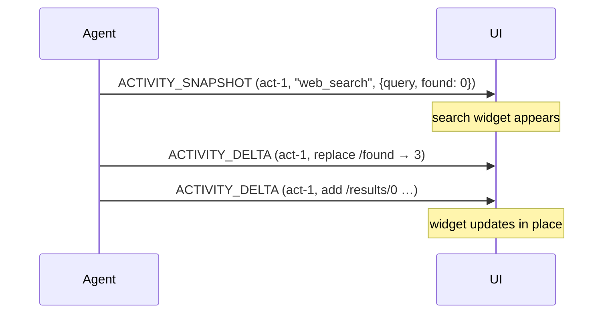

<em class="lead">UI 作为自有组件渲染的结构化进度，保持在消息序列中</em>

活动是并非会话内容的结构化进度——一次正在运行的搜索、
一份正在填入的清单、一个 UI 作为自有组件渲染的
步骤。它被物化为一条消息，以便在序列中保持其位置，
但其内容是一个对象，而非文本。

## 事件 {#events}

活动绑定[快照–增量模式](../basic/patterns/snapshots.md)，
按每条活动消息划界，按 `messageId` 匹配。

### `ACTIVITY_SNAPSHOT` {#activity_snapshot}

创建或替换一条活动消息。

```json
{
  "type": "ACTIVITY_SNAPSHOT",
  "messageId": "act-1",
  "activityType": "web_search",
  "content": { "query": "…", "found": 3 }
}
```

- `activityType` 是一个开放字符串：该集合属于
  生产方，而非协议。消费方 MUST 容忍它无法
  识别的类型。
- 一个针对消费方未见过的 `messageId` 的快照
  会创建该活动消息，按到达时的位置插入序列。
- 一个针对已存在活动的快照会替换其内容与
  其 `activityType`。`replace` 是 OPTIONAL；
  缺失意味着替换，且该含义是规范性的。
  显式的 `replace: false` 请求消费方让已存在的
  消息维持原状——内容*与* `activityType`；
  快照自身的值仅在该快照创建消息时适用。
  它不是合并。
- 替换替换的是*内容*，而非迄今累积的元数据——
  元数据继续按[元数据规则](../basic/metadata.md)
  合并。归属是例外：一个用于替换的快照会
  重新铸造该活动，因此消息的 `subagentRunId`
  变为快照自身的，包括变为缺失。
- 一个针对已存在活动的 `replace: false` 快照不
  重新铸造所有权：已确立的所有者仍然有效，
  且快照自身的归属 MUST 与之相符。生产方的
  义务与[子智能体规则](../events/subagents.md)
  施加于流式延续的那一条相同；消费方的义务
  被刻意设得更弱——已确立的所有者仍然有效，
  且消费方无义务拒绝不一致，而流式延续的
  不匹配则必须被拒绝。

### `ACTIVITY_DELTA` {#activity_delta}

以一个 RFC 6902 补丁修正一条活动消息的内容，
补丁以其当前内容为相对基线。增量的
`activityType` 会替换消息的——一个增量 MAY 重新
设定它所修正的活动的类型，而不打算如此
的增量 MUST 重复当前类型，因为该字段是必需的。

- 生产方 MUST NOT 为一个它没有以快照创建的
  活动消息发送增量——快照是
  [该模式](../basic/patterns/snapshots.md) 要求的基线。
- 一个指名不存在消息、或指名一条非活动消息的
  增量被跳过；消费方 SHOULD 呈现一条警告，
  且 MUST NOT 使运行失败。
- 补丁后的结果 MUST 仍然是一个对象：按 schema，
  `content` 是一个对象，且生产方 MUST NOT 发送
  应用后会使它变成任何其他东西的补丁——例如
  一次根替换。消费方无义务检测该违规。
- 补丁失败处理遵循
  [该模式](../basic/patterns/snapshots.md#when-a-patch-does-not-apply)，
  重新同步方式为以同一 `messageId` 的全新快照。

## 会话中的活动消息 {#activity-messages-in-the-conversation}

一条活动消息以固定的 role `activity` 出现在
历史中。它是供消费方渲染的材料，而非智能体
从中恢复的会话：消费方 MUST 把活动消息从它
在[运行输入](../basic/run-input.md) 中发送的
`messages` 里剥离。活动消息如何在一个
`MESSAGES_SNAPSHOT` 之后存活，规定在
[该事件](../events/state.md#messages_snapshot) 处。

## 消息流 {#message-flow}



## 数据类型 {#data-types}

[`ActivitySnapshotEvent`](../schema.md#activitysnapshotevent)、[`ActivityDeltaEvent`](../schema.md#activitydeltaevent)
与 [`ActivityMessage`](../schema.md#activitymessage) 由
[schema 参考](../schema.md) 定义。[`ActivityMessage`](../schema.md#activitymessage) 是
独立定义的，而非组合基础消息，因为其内容是对象
而非字符串。

## 错误处理 {#error-handling}

格式错误的活动事件作为格式错误的已知值是致命的。
两种被容忍的失败——针对缺失或非活动消息的
增量，以及一个格式良好但不适用的补丁——
如上文那样警告并跳过；两者都会使生产方与
消费方可能对该活动失去一致，而生产方的
下一个快照会修复这一点。
