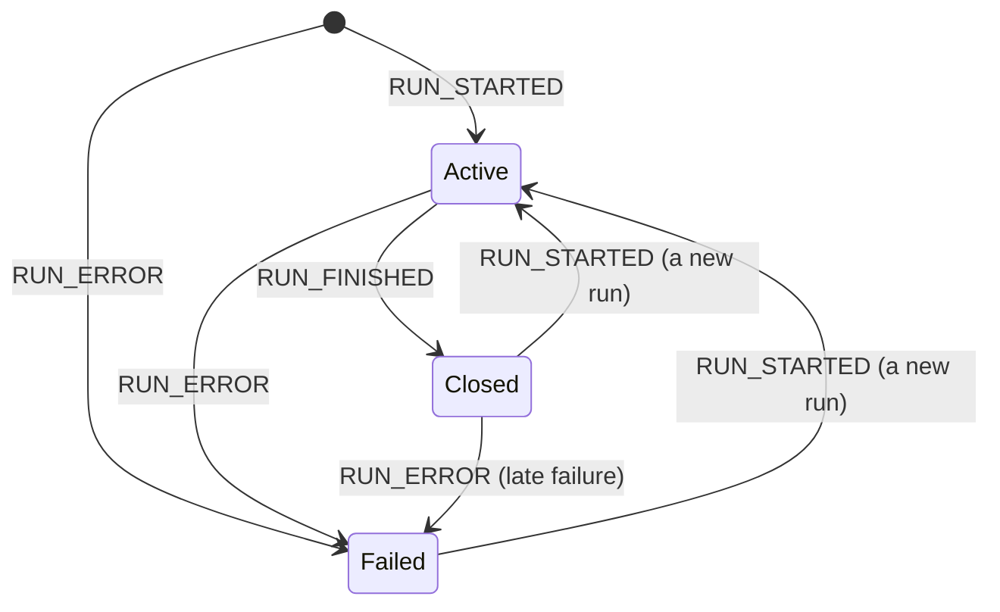

<em class="lead">运行何时开始与结束、其间可能发生什么，以及步骤如何标记其各阶段</em>

消费方发送一个 [`RunAgentInput`](../basic/run-input.md)；生产方以一条事件流作答，
其中携带一个或多个运行——被请求的那个运行，前面可能跟着重放的会话历史。
本页说明运行何时开始与结束、这些边界意味着什么；运行*内部*的排序规则属于
[事件模式](../basic/patterns/index.md)。

## 运行 {#the-run}

一条流 MUST 以 `RUN_STARTED` 或 `RUN_ERROR` 开始。生产方 MUST NOT 先发出任何其他
事件，而消费方 MUST 把以其他任何内容开头的流视为协议违规。允许 `RUN_ERROR`
先到达，是因为一个运行可以在开始之前就已失败——一条无法触及智能体的传输
有一项失败要上报，却没有一个可用来上报该失败的运行。

### `RUN_STARTED` {#run_started}

开启一个运行。它携带该运行的标识符；生产方自己的
`protocolVersion` 声明，遵循[版本规则](../basic/versioning.md#version-negotiation)；并且 MAY
回显启动该运行所用的输入，这样未发起请求的消费方也能看到智能体
收到了什么请求。`parentRunId` 指出派生本运行的那个运行——
当一个智能体把另一个智能体作为独立运行来调用，而非作为单个运行内的
[子智能体](../events/subagents.md) 时。
### `RUN_FINISHED` {#run_finished}

关闭一个未失败的运行，并报告它是如何结束的：

- 其 `outcome` 区分完成的运行、等待外部输入而中断的运行，以及在完成前被停止的运行；
  缺失的 outcome 表示成功。interrupt outcome 及其后续内容由
  [中断与恢复](../basic/patterns/interrupt-resume.md) 规定；
  cancelled outcome 在[下方](#cancelled-runs)规定。outcome 报告的是
  生产方所知晓的运行结束原因：因[前端工具调用](../events/tool-calls.md#frontend-tools)
  而停止的运行是一个已完成的运行，其 success outcome MAY 在
  `pendingToolCallIds` 中点名那些被搁置未答的调用，因为应用是否在
  此类调用之后继续会话是应用的决定，而非生产方的决定。
- 生产方 MUST NOT 发送 schema 未描述的 outcome 值。
- `result` 是 OPTIONAL，携带运行若有返回值的返回值。
- `usage` 是 OPTIONAL，报告 token 用量，每个提供方和模型各一条
  条目，按[下方](#token-usage)的核算方式。只想获取合计的消费方
  对各条目求和即可。
消费方无法识别的 outcome 与其他无法识别的内容一样，按相同条件被剥离。
剥离一个可选字段后该字段即缺失，而缺失的 outcome 意味着成功——因此
消费方无义务区分完成的运行与那种因在该消费方发布之后才被命名的
原因而结束的运行的差别。

::::
这限制了 outcome 集合能够有意义地增长的幅度。稍后版本加入的终态
到达较老的消费方时表现为一个成功的运行，因此需要较老消费方*注意到*
一种新结束方式的版本无法仅通过 `outcome` 表达这一点——它需要一个
那些消费方已经视为重要的载体。这也是为什么下方的 cancelled outcome
在 1.0 中被命名而非留待以后：若事后加入，一个被取消的运行会到达
每个 1.0 消费方并表现为已完成的运行。
::::
### 被取消的运行 {#cancelled-runs}

一个运行可以在完成之前被有意停止——由为其运行的人、由应用自身的代码、
或由生产方强制执行的某个限制。它并未失败，也没有在等待什么，
但它同样未完成；无法把它与完成的运行区分开的消费方，会把部分
工作当作全部呈现。cancelled outcome 命名的就是这种结局。

- 一个在完成前停止运行的生产方，若原因不是失败，MUST 以携带
  cancelled outcome 的 `RUN_FINISHED` 关闭它。它 MUST NOT 把被停止的运行
  报告为成功——既不能用 success outcome，也不能靠省略 outcome。
- 对已关闭运行成立的规则在此同样成立。生产方 MUST 在使该运行被取消的
  `RUN_FINISHED` 之前关闭该运行所开启的一切——消息、工具调用、步骤、
  子智能体——正如在成功的 `RUN_FINISHED` 之前那样。关闭一个工具调用
  确立的是其参数文本已完整，而非其有效，因此一个在参数中途被切断的
  调用与其他调用一样被关闭，而对无法解析的参数如何处理是应用的决定，
  见[工具调用规则](../events/tool-calls.md#tool_call_end)。无法按序关闭的
  生产方——停止摧毁了其下的流——改报 `RUN_ERROR`：那个运行并非干净地
  结束，而 `RUN_ERROR` 正是为未干净结束的运行而设的事件。
- 被取消的运行没有返回值：`result` SHOULD 缺失。`usage` MAY 报告
  停止前累积的 token。
- 被取消的运行不等待任何东西。其 outcome 不携带任何中断，该会话上
  的下一个运行是一个普通的新运行，而非一次恢复。
- 消费方 MUST NOT 把一个被取消的运行动态呈现为已成功，也 MUST NOT 将其
  呈现为已失败——用户请求的停止不是一个应当向其展示的错误。运行在停止前
  交付的一切保持已交付状态，如同 `RUN_ERROR` 之后。除此之外如何呈现该停止
  是消费方自己的事。
取消是生产方对一个其曾运行的运行的报告。一个放弃某条流的消费方——
关闭连接、停止读取——面对的是一个[截断的运行](../basic/transports/index.md#truncation)，
而非被取消的运行：它 MUST NOT 为它从未收到结局的运行合成
一个 `RUN_FINISHED`，无论是否标记为取消。

### `RUN_ERROR` {#run_error}

结束一个失败的运行。`message` 说明出了什么问题，供人阅读；
`code` 是 OPTIONAL 且机器可读，是协议未定义词表的开放字符串；
`usage` MAY 按与 `RUN_FINISHED` 相同的[核算](#token-usage)
报告失败前累积的 token。

一个 `RUN_ERROR` 是格式良好的事件：生产方是在报告它自己的失败，
而非发送消费方应当拒绝的内容。把一个运行当作失败，意味着消费方
MUST 把该失败呈现给应用代码，且 MUST NOT 报告该运行为成功。
协议不规定具体方式——启动该运行的调用是抛出异常、以失败解决、
还是通过回调上报，是实现自己的事，两个符合的消费方可能做法不同。
### Token 用量 {#token-usage}

`RUN_FINISHED` 和 `RUN_ERROR` 上的 `usage` 报告该运行的模型调用花费了多少，
每个提供方和模型各一条 [`TokenUsage`](../schema.md#tokenusage) 条目。
各提供方的计数方式不同——一家把缓存的提示 token 计入其输入计数，
另一家将其并列报告，还有一家把推理单独于输出的其余部分报告——
因此协议固定了一种核算方式，生产方将其翻译进去。每个计数
要么是总量，要么是某个总量的命名部分：

- `inputTokens` 是该调用被计费的全部提示 token：无论是否缓存、
  是否写入缓存、是否为文本。`outputTokens` 是生成的全部 token，
  包含推理。
- `cachedInputTokens`（缓存读取）、`cacheWriteInputTokens`（缓存写入）与
  `reasoningTokens` 是那些总量的组成部分，永不追加于总量之上。
  两个缓存计数互不相交。若生产方的提供方将其中某项并列于
  一个更小的总量报告，生产方 MUST 在发出该条目前将其加入总量；
  若提供方的总量已包含该项，生产方 MUST NOT 重复加入。
- `totalTokens` 是 `inputTokens` 加 `outputTokens`。生产方 MAY 自行计算，
  而非照抄提供方的总量，且 MUST NOT 照抄一个计数方式不同的提供方总量。
- 计数缺失表示提供方未报告；计数为零表示提供方报告为零。
  生产方 MUST NOT 对其没有数据的计数发出零值，消费方 MUST NOT
  把缺失的计数读作零。
运行是核算的边界：

- usage 覆盖运行内发生的每次模型调用，包括由其
  [子智能体](../events/subagents.md) 发起的调用：子智能体事件不携带
  自己的 usage，子智能体的调用就是这个运行的调用。
- 作为独立运行被调用的智能体——由 `parentRunId` 指名——在自己的
  终态事件上报告自己的 usage，派生它的运行 MUST NOT 把该 usage
  计入自己的。
- [恢复](../basic/patterns/interrupt-resume.md)一个被中断运行的运行
  只报告其自身发起的调用。被中断的运行已报告过自己的，想要
  会话合计的消费方对该会话各运行的用量求和即可。

在这种核算下，只想要合计的消费方对各条目和各运行的 `totalTokens`
求和；要计算成本的消费方则手握所需各部分，可按各自费率对缓存读取、
缓存写入与推理分别计价，且不会重复计算其中任何一项。

### 运行关闭之后 {#after-a-run-closes}

一个运行以 `RUN_FINISHED` 或 `RUN_ERROR` 结束，此后即关闭。
一旦运行已关闭：

- 生产方 MUST NOT 再为该运行发出任何事件，以下两个指名的事件除外。
- 生产方 MAY 发出 `RUN_STARTED`，在同一条流上开始一个新运行。
- 生产方 MAY 在 `RUN_FINISHED` 之后发出 `RUN_ERROR`，报告一个在运行
  报告成功之后才浮现的失败——例如刷写期间的传输错误。
  此时消费方 MUST 把该运行当作失败处理。
- 生产方 MUST NOT 在 `RUN_ERROR` 之后发出除 `RUN_STARTED` 之外的任何内容。

消费方 MUST 拒绝在运行关闭之后到达的任何其他事件。

### 一条流上的多个运行 {#several-runs-on-one-stream}

一条流 MAY 顺序承载多个运行——重放的会话是常见情形。
生产方 MUST 在开启下一个运行之前关闭当前运行：在运行仍活跃时
发出 `RUN_STARTED` 即为违规。
跨同一条流内的多个运行时，消息会累积，
[状态](../events/state.md) 会保持，除非某个事件替换它。
一个复述历史的生产方——重放一个其内容消费方输入中已经携带的
会话——MUST 以快照形式复述：`MESSAGES_SNAPSHOT`
按 id 对账，`STATE_SNAPSHOT` 则整体替换，因此消费方已持有的
复述是幂等的。把消费方已拥有的消息重新流式传输，
会追加到该消息而非复述它——这正是流式三件套
只用于新材料的原因。

以运行为单位的跟踪——开启中的消息、开启中的工具调用、开启中的步骤、
活跃的子智能体——不跨越该边界：`RUN_FINISHED` 要求该运行所开启的
一切此时均已关闭，而 `RUN_ERROR` 连同运行一起结束一切仍开启之物。
一个新运行从一无所开开始。

## 步骤 {#steps}

步骤标记一个运行的各阶段，供展示进度的 UI 使用。
`STEP_STARTED` 开启一个步骤，`STEP_FINISHED` 关闭它，
两者按 `stepName` 配对。

- 生产方 MUST NOT 开启一个名称已处于开启状态的步骤，
  MUST NOT 关闭一个从未开启的步骤。
- 生产方开启的每个步骤 MUST 在运行结束前被关闭。
- 步骤 MAY 相互重叠，也可与运行中的其他任何事物重叠；
  步骤是覆盖流上某一段的标签，而非容器。

## 数据类型 {#data-types}

事件结构由 [schema 参考](../schema.md) 定义：
[`RunStartedEvent`](../schema.md#runstartedevent)、[`RunFinishedEvent`](../schema.md#runfinishedevent)（含 [`RunFinishedOutcome`](../schema.md#runfinishedoutcome)）、
[`RunErrorEvent`](../schema.md#runerrorevent)、[`StepStartedEvent`](../schema.md#stepstartedevent)、[`StepFinishedEvent`](../schema.md#stepfinishedevent)，以及 [`TokenUsage`](../schema.md#tokenusage)。

## 错误处理 {#error-handling}

两种不同的情况会以糟糕的方式结束一个运行，而消费方须将二者区分开。

一个**被消费方拒绝的流**是它所检测到的协议违规：
本页上生产方 MUST NOT 做的每一件事，一旦被消费方看到即是
致命的——`RUN_STARTED` 之前的事件、关闭之后除被允许的两个之外的
事件、嵌套的 `RUN_STARTED`、不配对的步骤，或 `RUN_FINISHED` 时
仍开启的任何事物。生产方有过失，该流不可信。

一个**以 `RUN_ERROR` 报告自身失败的运行**则恰好相反：
一个符合的生产方在声明其工作未成功。该流格式良好，
消费方按上述规则接受它。

消费方 MUST NOT 把一种呈现为另一种。两种情形下的失败运行
都保持其失败前已交付的一切——`RUN_ERROR` 说的是运行未完成，
而非其事件未发生。
