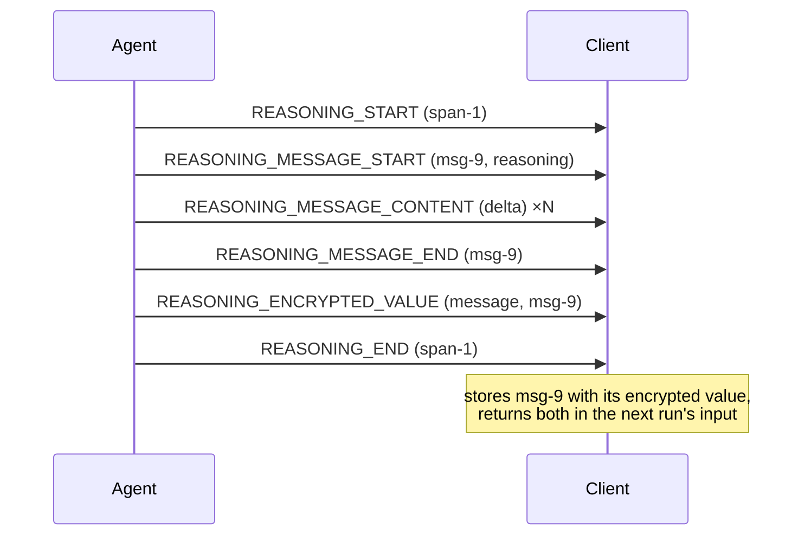

<em class="lead">流式传输模型的思考内容，并往返那些它不得泄露之物</em>

推理是模型在作答之前的思考。生产方将其流式传输，
以便 UI 可以展示进行中的工作；并且——当提供方
将真实的思考链保密时——携带一个加密制品，
消费方将其存储并原样返回，却无法读取。

## 用户交互模型 {#user-interaction-model}

推理通常独立于会话渲染——默认折叠，以“思考”的
样式呈现。协议不强制任何呈现方式；消费方 MAY
完全隐藏推理。

## 事件 {#events}

### 区间：`REASONING_START` 与 `REASONING_END` {#spans-reasoning_start-and-reasoning_end}

一个推理区间框住一段思考，由
`REASONING_START` 开启、由 `REASONING_END` 关闭，
按 `messageId` 匹配。一个区间 MAY 包含
多个推理消息。

- 生产方 MUST NOT 开启一个 `messageId` 已处于
  开启状态的区间，MUST 在运行结束前关闭它开启的
  每个区间，且 MUST NOT 关闭它未开启的区间。
- 区间的标识符不划出任何命名空间：
  区间内的推理消息携带它们自己的 `messageId`。

### 推理消息 {#reasoning-messages}

推理消息遵循[流式模式](../basic/patterns/streaming.md)：
`REASONING_MESSAGE_START` 开启一条（其 `role` 固定为
`reasoning`），`REASONING_MESSAGE_CONTENT` 扩展它，
`REASONING_MESSAGE_END` 关闭它，全部按
`messageId` 匹配——而 `REASONING_MESSAGE_CHUNK` 是
紧凑写法，其首个 chunk MUST 携带 `messageId`。
该模式的规则与文本消息完全相同地适用。

消费方 MUST 检测该纪律的违规并使运行失败，
无论违规发生在区间上还是推理消息上：

- 一个指名了一条无人开启的消息的
  `REASONING_MESSAGE_CONTENT` 或 `REASONING_MESSAGE_END`
  没有所指，消费方 MUST NOT 杜撰一个孤立片段
  所指名的消息。相同的形状在文本消息上同样被拒绝；
  推理不是例外。
- 一个指名了一个无人开启的区间的 `REASONING_END`
  以同样方式被拒绝，一个重新打开已开启区间的
  `REASONING_START` 亦然。
- 一个指名一条已开启推理消息的
  `REASONING_MESSAGE_START` 同样被拒绝——该消息
  必须先以 `REASONING_MESSAGE_END` 关闭，其
  `messageId` 才能再次使用。一个区间与其内部的消息
  MAY 共享同一个标识符，因此各自对照自己的
  开启集合检查。
- 运行结束时仍开启的区间或推理消息使运行失败。

区间与推理消息是相互独立的命名空间：
一个 `REASONING_START` 只开启一个区间而不开启
任何消息，因此一个指名区间 `messageId` 的片段
与其他片段一样是孤立的。
### `REASONING_ENCRYPTED_VALUE` {#reasoning_encrypted_value}

携带提供方不透明的、加密的推理制品。`subtype` 说明
`entityId` 所指何物——一条消息还是一次工具调用——
这决定了该值存放的位置。

- 消费方 MUST 把 `encryptedValue` 当作不透明值：
  绝不解析、绝不解释、绝不假定它是任何特定格式。
- 消费方 MUST 将该值与其所指名的消息或工具调用
  一同存储，并在后续运行输入中原样返回，使生产方
  能恢复该制品所代表的推理上下文。该规则假定存在
  能容纳它的目标：按 schema，活动消息不携带加密
  值，因此一个指名活动消息的事件被当作指名了消费方
  所不知之物——即下方的未知 `entityId` 情形。
- 一个无法保留它的消费方——降级路径、无法承载
  它的存储——正在丢失内容，且 MUST 警告
  （[版本](../basic/versioning.md)）。
- 制品随其消息同行。一个复述该消息的
  [`MESSAGES_SNAPSHOT`](../events/state.md) 会整体
  替换它，包括 `encryptedValue`——因此仍需要该制品的
  生产方 MUST 在快照的副本中重新陈述它，而省略它的
  生产方等于撤回了自己的制品。消费方的义务是把
  所有事件应用完毕后自己持有的东西原样返回，而非
  复活快照所移除的东西。

该事件是独立的：它不开启任何东西、不关闭任何东西，
MAY 出现在一个开启中的运行内的任何位置，尽管按
惯例它到达于捕获其思考的那个区间内部。

## 消息流 {#message-flow}

## 数据类型 {#data-types}

事件结构由 [schema 参考](../schema.md) 定义：
[`ReasoningStartEvent`](../schema.md#reasoningstartevent)、[`ReasoningEndEvent`](../schema.md#reasoningendevent)、[`ReasoningMessageStartEvent`](../schema.md#reasoningmessagestartevent)、
[`ReasoningMessageContentEvent`](../schema.md#reasoningmessagecontentevent)、[`ReasoningMessageEndEvent`](../schema.md#reasoningmessageendevent)、
[`ReasoningMessageChunkEvent`](../schema.md#reasoningmessagechunkevent)、[`ReasoningEncryptedValueEvent`](../schema.md#reasoningencryptedvalueevent)。
在会话历史中，一条推理消息是一条
[`ReasoningMessage`](../schema.md#reasoningmessage)。

## 错误处理 {#error-handling}

一个 `entityId` 未指名任何消费方所知之物的
`REASONING_ENCRYPTED_VALUE` 无法存放到其应处的位置；
消费方 SHOULD 警告，并 MAY 丢弃它，且 MUST NOT
因此使运行失败。

一个格式错误的推理事件——缺失必需字段、
一个非字符串的 `subtype`——是格式错误的已知值，
与其他情况一样致命。一个取值是 schema 未命名
字符串的 `subtype` 则不同：它是无法识别的内容——
该消费方发布之后新加入的成员——而
[处理模型](../basic/processing.md) 会带警告地剥离它，
在必需位置上这会移除携带它的事件。

## 安全考量 {#security-considerations}

推理内容常规性地包含生产方选择在回答中
不曾言说的材料。消费方 SHOULD 以与会话相同
的保密级别对待它，且 MUST NOT 把一个
`encryptedValue` 交给签发它的生产方以外的
任何东西——它是一个恢复上下文的能力
（capability），而非应用的数据。
