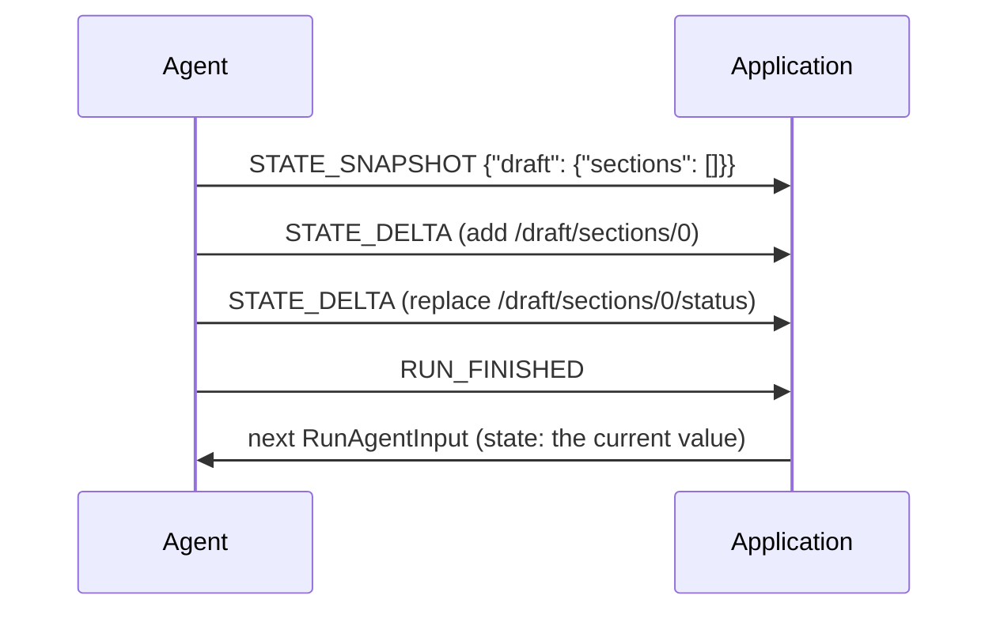

<em class="lead">共享状态与会话本身：整体替换，以补丁修正</em>

状态是智能体与应用之间保持同步的值——一份计划、
一个表单、一份正在构建中的文档。它按
[快照–增量模式](../basic/patterns/snapshots.md) 传输；
本页补充状态本身与会话自身快照
特有的部分。

## 事件 {#events}

### `STATE_SNAPSHOT` {#state_snapshot}

整体替换智能体状态。在一个增量无法表达
该变更时发送，或用于重新同步一个消费方。
消费方 MUST 以 `snapshot` 替换其状态——
不做合并。

### `STATE_DELTA` {#state_delta}

以一个 RFC 6902 补丁修正当前状态。基线是
消费方当前的状态：在运行开始时，是输入中的
`state`；此后，则是该运行自己的快照与增量
已使之成为的样子。[该模式](../basic/patterns/snapshots.md)
就补丁所说的一切——原子应用、开放的操作、
失败处理、重新同步——原样适用。

### `MESSAGES_SNAPSHOT` {#messages_snapshot}

生产方所拥有的完整消息集合，按序排列。

它是会话范围的，而非简单的整体覆盖，因为消费方
可能持有某些生产方不跟踪的消息。对账方式如下：

- 快照中的一条消息替换消费方处同 id 的副本——
  *原地*：消费方为其已持有的消息保留其
  既有位置。消费方从未见过的快照消息被
  追加，按快照顺序。因此快照的顺序只对
  消费方初次遇到的消息具有权威性；它不会
  重排消费方已拥有的消息。
- 消费方持有而*不在*快照中的消息被丢弃——
  生产方是在声明完整集合——**但**不包括
  生产方无从得知的纯客户端材料：
  [活动](../events/activity.md) 消息（它们从不
  传输到生产方）与推理消息（多数生产方
  不跟踪）。
- 该例外是按角色的、且会自我撤销：一个
  自身携带任何活动消息的快照，正是在声明
  完整的活动集合，消费方处不在其中的活动
  消息与其他任何东西一样被丢弃。推理消息
  适用相同规则。

因为是会话范围的，快照自身不携带
`subagentRunId`；它通过所包含的消息
确立每条消息的所有权。

## 跨运行行为 {#cross-run-behaviour}

状态在一个会话的各运行之间保持，直到某个事件替换它，
且下一个运行的输入将其带回作为起始值——
这个循环使双方保持一致。消息以同样的方式累积；
`MESSAGES_SNAPSHOT` 是生产方直接复述该累积的方式。

## 消息流 {#message-flow}

## 数据类型 {#data-types}

[`StateSnapshotEvent`](../schema.md#statesnapshotevent)、[`StateDeltaEvent`](../schema.md#statedeltaevent)
与 [`MessagesSnapshotEvent`](../schema.md#messagessnapshotevent) 由
[schema 参考](../schema.md) 定义，其中 [`State`](../schema.md#state) 被
刻意不加约束——任何 JSON 值，而不只是对象——且增量是
[`JsonPatch`](../schema.md#jsonpatch)。

## 错误处理 {#error-handling}

结构上格式错误的补丁是致命的；一个格式良好但
应用失败的补丁会被警告并跳过，遵循
[该模式](../basic/patterns/snapshots.md#when-a-patch-does-not-apply)。

## 安全考量 {#security-considerations}

状态事件是对应用状态的远程写入。应用在采取
行动之前 MUST 校验它从状态中读出的东西——渲染它、
执行它、因它而授予任何东西——正如它会校验
任何其他跨越信任边界的输入。相应地，生产方
SHOULD NOT 把秘密放进状态：它在每次运行中
都经消费方往返一圈。
