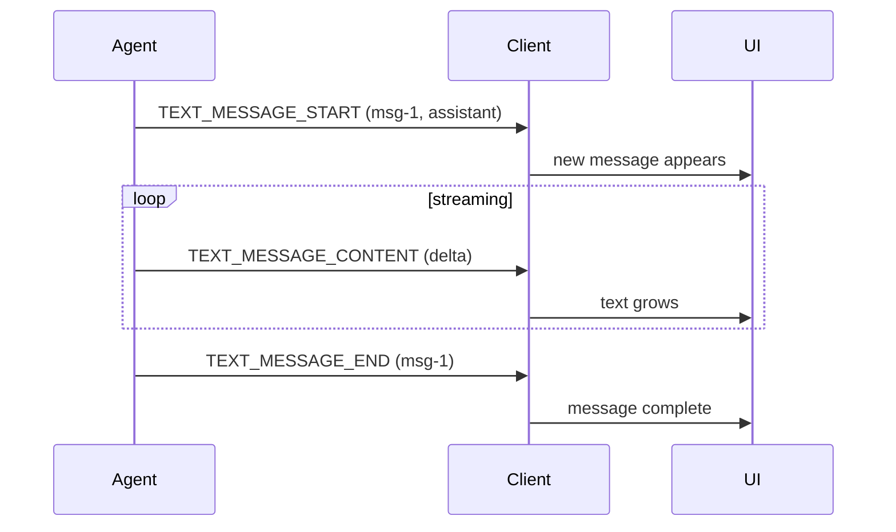

<em class="lead">智能体向用户流式传输的会话文本</em>

文本消息就是会话本身：用户读到的那些文字。生产方在每条消息
生成的同时将其流式传输，这样 UI 就能在文字到达时即时渲染，
而无需等待整条消息完成。

## 用户交互模型 {#user-interaction-model}

文本消息通常以会话转录的形式渲染，每条消息随其内容的流式
到达而增量呈现。协议不强制任何特定的呈现方式——消费方 MAY
在显示前先缓冲整条消息，也可以逐 token 渲染。

## 事件 {#events}

文本消息遵循[流式模式](../basic/patterns/streaming.md)，
按 `messageId` 匹配。该模式的规则——先开启再传内容、
在运行结束前关闭、不得重新打开已开启的 id——
按其原文适用。

### `TEXT_MESSAGE_START` {#text_message_start}

开启一条消息。

```json
{
  "type": "TEXT_MESSAGE_START",
  "messageId": "msg-1",
  "role": "assistant"
}
```

- `role` 是 OPTIONAL；缺失的 role 意味着 `assistant`。
  role 可取的值是 [schema](../schema.md#textmessagerole) 的事。
- `name` 是 OPTIONAL，用于在同一 role 内标注说话者，
  供需要区分多个说话者的生产方使用。
### `TEXT_MESSAGE_CONTENT` {#text_message_content}

扩展一条开启中的消息。`delta` 携带该消息文本的下一片段；
各 delta 按到达顺序拼接。

```json
{
  "type": "TEXT_MESSAGE_CONTENT",
  "messageId": "msg-1",
  "delta": "Hello, world."
}
```

### `TEXT_MESSAGE_END` {#text_message_end}

关闭一条消息。已关闭的消息是被关闭而非被封死：生产方 MAY
以一个新的 `TEXT_MESSAGE_START` 重新打开同一个 `messageId`，
消息得以延续，其后续内容追加到已有内容之后。一个用于
重新打开的 `TEXT_MESSAGE_START` MUST 与其重新打开的消息
一致——同一所有者、同一 `role`、同一 `name`；消息已确立的
值仍然有效，消费方无义务检测不一致。其后一个
[`MESSAGES_SNAPSHOT`](../events/state.md) 也 MAY 整体复述
该消息。没有任何事件能以其他任何方式改变一条已关闭消息的内容。

!!! note
    在一个运行内，以不同所有者进行的重新打开，就是
    [子智能体规则](../events/subagents.md) 已经拒绝的归属
    不匹配。跨运行时，消费方的所有权跟踪已经重置，这正是
    跨运行的不匹配检测不是必需的——无论哪种情形，
    生产方的义务都是相同的。

### `TEXT_MESSAGE_CHUNK` {#text_message_chunk}

紧凑写法。消费方 MUST 按
[流式模式](../basic/patterns/streaming.md#the-chunked-form)
的规定把各 chunk 展开为上述三个事件，包括首 chunk 的
要求与冲突重复规则。

## 消息流 {#message-flow}


## 数据类型 {#data-types}

事件结构由 [schema 参考](../schema.md) 定义：
[`TextMessageStartEvent`](../schema.md#textmessagestartevent)、[`TextMessageContentEvent`](../schema.md#textmessagecontentevent)、[`TextMessageEndEvent`](../schema.md#textmessageendevent)、
[`TextMessageChunkEvent`](../schema.md#textmessagechunkevent)。组装完成的
消息按其在会话历史中的角色表现为
[`AssistantMessage`](../schema.md#assistantmessage)、[`UserMessage`](../schema.md#usermessage)、[`SystemMessage`](../schema.md#systemmessage)
或 [`DeveloperMessage`](../schema.md#developermessage)。

消息任一事件上的元数据按
[元数据规则](../basic/metadata.md) 并入该消息：
逐键合并，最后一次写入生效。

## 错误处理 {#error-handling}

对一个未开启的 `messageId` 发出 `TEXT_MESSAGE_CONTENT`
或 `TEXT_MESSAGE_END`，或对一个已开启的 `messageId` 发出
`TEXT_MESSAGE_START`，都是格式错误的序列，对本运行是致命的。
运行结束时仍开启的消息同样是违规。这些都是
[流式模式](../basic/patterns/streaming.md) 的规则；
关于文本消息没有任何地方放宽它们。
