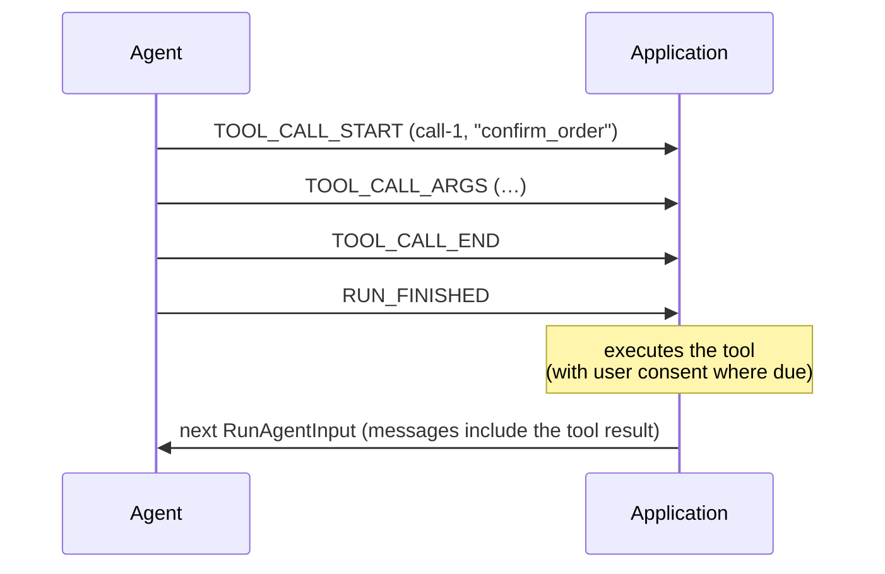

<em class="lead">智能体如何提议一次调用、流式传输其参数，并接收其结果</em>

工具调用是智能体请求某事被执行。当该工具是应用在其
[运行输入](../basic/run-input.md) 中声明过的之一时，
由应用执行它——这使得工具调用成为本协议
人机协同（human-in-the-loop）的核心：智能体提议，应用定夺。

## 用户交互模型 {#user-interaction-model}

应用通常在某次工具调用流式传输时将其呈现——一张标有
工具名的卡片，参数逐次填入——并且对有副作用的
工具，在执行前先询问用户。协议不强制任何特定的交互
模型，但见下方的[安全考量](#security-considerations)。

## 事件 {#events}

工具调用遵循[流式模式](../basic/patterns/streaming.md)，
按 `toolCallId` 匹配。

### `TOOL_CALL_START` {#tool_call_start}

开启一次调用。

```json
{
  "type": "TOOL_CALL_START",
  "toolCallId": "call-1",
  "toolCallName": "search",
  "parentMessageId": "msg-1"
}
```

- `toolCallName` 点名被调用的工具。
- `parentMessageId` 是 OPTIONAL，把该调用附着到携带它的
  助手消息上。当父消息归属于某个子智能体时，
  该调用 MUST 与该归属一致——工具调用属于携带它的
  消息（见[子智能体](../events/subagents.md)）。

### `TOOL_CALL_ARGS` {#tool_call_args}

扩展一次开启中的调用。`delta` 携带该调用参数的下一片段；
拼接后的各 delta 构成该调用的参数文本，按惯例是一个
JSON 文档——但协议以文本形式承载它且不校验它，
这是刻意为之：提供方会发出格式错误的参数字符串，
而由应用决定如何处理它，胜过让传输层杀死整个运行。

在 `TOOL_CALL_END` 之前，消费方 MUST NOT 对该参数采取任何
行动：在调用关闭之前，该文本只是生产方所发送之物的一个
前缀，而非事物本身。

### `TOOL_CALL_END` {#tool_call_end}

关闭一次调用。参数文本此时完整——关闭确立的是
完整性，而非有效性。执行该工具的一方负责解析它，
对无法解析的文本如何处理是应用的决定，而非
协议违规。

已关闭的调用与已关闭的消息一样，MAY 被一个新的
`TOOL_CALL_START` 以同一个 `toolCallId` 重新打开，
后续参数继续追加。用于重新打开的 start MUST
与其重新打开的调用一致——同一 `toolCallName`、
同一 `parentMessageId`、同一所有者。消费方无义务
检测不一致，而且不同于[被重新打开的文本消息](../events/text-messages.md#text_message_end)，
协议对一个漏掉违规的消费方最终持有两个值中的
哪一个不做任何保证。

### `TOOL_CALL_CHUNK` {#tool_call_chunk}

紧凑写法。消费方 MUST 按
[流式模式](../basic/patterns/streaming.md#the-chunked-form)
的规定展开各 chunk：首个 chunk MUST 携带
`toolCallId` 和 `toolCallName`，而延续 chunk 若以冲突的
值重复 `toolCallName` 或 `parentMessageId`，即为致命。

### `TOOL_CALL_RESULT` {#tool_call_result}

携带一次调用的结果。它本身是一条消息——一条拥有
自己 `messageId` 的工具消息——并不重新打开它所应答的
调用。

```json
{
  "type": "TOOL_CALL_RESULT",
  "messageId": "msg-2",
  "toolCallId": "call-1",
  "content": "3 results found."
}
```

结果 MAY 与其调用出现在同一个运行中——由智能体执行的
工具——也可能根本不出现在流中：客户端执行的工具的结果
作为工具消息返回到下一个运行的输入中，回到生产方那里。

#### 结果内容 {#result-content}

`content` MUST 是一个字符串，或一个按序排列的
[`ContentPart`](../schema.md#contentpart) 列表——与
[用户消息](../basic/run-input.md#messages) 携带的是
同样的部件：`text`、`image`、`audio`、`video` 与
`document`，每个媒体部件带有一个 `source`，可以是
内联数据、一个 URL，或一个
[提供方文件句柄](../basic/run-input.md#provider-file-handles)。
该事件铸造出的工具消息形状完全相同，因此一个结果
可以原封不动地进入下一个运行的 `messages`。

```json
{
  "type": "TOOL_CALL_RESULT",
  "messageId": "msg-2",
  "toolCallId": "call-1",
  "content": [
    { "type": "text", "text": "Invoice INV-2291 attached." },
    {
      "type": "document",
      "source": { "type": "url", "value": "https://example.com/INV-2291.pdf", "mimeType": "application/pdf" },
      "metadata": { "title": "INV-2291" }
    }
  ]
}
```

- 返回结构化数据的工具——例如一个 JSON 对象——把它序列化
  成字符串形式，或放进一个 `text` 部件。协议没有 JSON
  部件：每个提供方都接受文本形式的工具结果，而一个带类型的
  对象终究也要在提供方边界变成文本。
- 部件未建模的任何东西——一次搜索命中的来源与标题、
  一个文档的文件名——搭在该部件的 `metadata` 里。
  协议不定义提供方特定的结果块（带引用的搜索结果、
  浏览器状态）；需要其中一个的生产方将其映射到这些部件，
  或作为透传承载。
- 一个把输出上传到模型提供方的工具——一份生成的报告
  现在存放在提供方的文件存储中——返回该句柄作为一个
  `file` source，而非重发字节；与输入相同的
  [规则](../basic/run-input.md#provider-file-handles) 适用，
  渲染该结果的消费方把句柄当作不透明值处理。
- 一个收到其模型无法接受的部件的生产方——给纯文本
  模型一张图片、给不接受工具结果中任何媒体的提供方一段
  音频、另一个提供方签发的文件句柄——MUST NOT 因此使
  运行失败。它丢弃该部件并继续，正如
  [运行输入规则](../basic/run-input.md#messages) 已就用户
  内容所说的那样，而且它 MUST 仍然应答该调用：一个所有
  部件都被丢弃的结果以空字符串应答，因为一次被搁置未答的
  工具调用会被多数模型直接拒绝。
- 一个只能容纳字符串的对等方——渲染器、存储、遗留
  桥接——把一个部件列表按序拼接其 `text` 部件后渲染，
  其余忽略。这样是有损的，SHOULD 予以声明，如同任何
  降级一样（[版本](../basic/versioning.md)）。
- 一个内容部件出现之前的对等方不发送 `protocolVersion`；
  知道自己与之对话的生产方 MAY 在发出之前以同样的方式
  压平一个结果，且当压平丢弃了部件时 MUST 警告。
  它 MUST NOT 在丢弃部件的位置放占位符：降级是
  重塑，而非杜撰。

## 前端工具 {#frontend-tools}

[运行输入](../basic/run-input.md#tools) 中的 `tools` 列表
属于应用：智能体提议一次调用，应用执行它。
协议没有来自消费方的运行中通道，因此应答只能
跨越运行边界——这赋予了往返其形状：
- 调用前端工具的生产方 MUST NOT 应答它：不发
  `TOOL_CALL_RESULT`，不伪造工具消息。结果由
  应用来生产。
- 生产方以调用未应答的状态结束运行。它 MUST 使用
  success outcome，或什么都不带，且 MUST NOT 把运行
  报告为被中断——并且一旦不再剩下任何不依赖于
  该结果的剩余工作，它 SHOULD 尽快收尾。一个运行
  MAY 留下多个未应答的前端调用；应用一次性应答
  它们全部。
- success outcome 的 `pendingToolCallIds` 按调用发起的
  顺序点名那些被搁置未答的调用。当一个运行留下
  未决调用时，生产方 SHOULD 发送它；发送时，列表
  MUST 恰好包含该运行发起且未以 `TOOL_CALL_RESULT`
  应答的工具调用。单独的 `RUN_FINISHED` 并不说明
  一个运行是否给应用留下了工作：当列表缺失或为空时，
  需要知道这一点的消费方从流中推导——该运行发起的
  所有未收到结果的工具调用——并且 MUST NOT 把缺失
  读作“无未决项”。在被中断的运行上，未决调用以
  同样方式推导；interrupt outcome 不携带它们。
- 运行结束后，应用对每个未应答的前端调用定夺——
  执行它，或拒绝它，附带其自身规则所需的任何
  同意。继续的会话 MUST 先应答其中每一个：下一个
  运行的 `messages` 为每次调用携带一条工具消息，
  按 `toolCallId` 对应——一次失败仍然是应答，
  即一条 `error` 置位的工具消息，而用户拒绝的调用
  以说明拒绝来应答。工具消息的 `content` 是字符串
  或部件列表，与
  [`TOOL_CALL_RESULT`](#result-content) 上完全相同：
  产出了截图或选中了文件的前端工具以媒体部件应答，
  而非对其描述。未应答的调用使智能体停在思路中途，
  而带有悬空调用的历史会被许多模型直接拒绝。
  放弃会话不回答任何东西，也不违反任何东西——
  规则约束的是继续，如同恢复覆盖一样。

这与[中断](../basic/patterns/interrupt-resume.md)
是不同的往返：中断是生产方显式停下来发问，
由恢复条目应答；前端工具调用走的是普通消息
循环，由会话历史应答。

!!! note
    因前端工具调用而停止的运行是一个已完成的运行，
    而非被中断的运行，它也不是第三种结局。outcome
    报告的是生产方所知晓的运行结束原因，而此处生产方
    并不知道自己是否在等待：前端工具往往是一个终态
    效果——渲染一张图表、导航、高亮——而其结果是否
    开启另一个运行是应用的决定，由该工具的应用规则
    作出。因此生产方陈述它知道的部分——运行已完成，
    且这些调用未应答——作为 success outcome 上的
    细节，那样一个剥离该字段的较老消费方仍读到一个
    成功的运行，并一如既往地推导未决调用。

一个生产方 SHOULD 只从声明过的列表中调用前端工具；
点名一个输入未声明过的工具的调用，其本身并不是
协议违规——如何处理它是消费方的决定。生产方自己的
工具由智能体一侧执行，从不需要声明，并通过
`TOOL_CALL_RESULT` 在流内应答。
## 消息流 {#message-flow}

一个客户端执行的工具横跨两个运行：



## 数据类型 {#data-types}

事件结构由 [schema 参考](../schema.md) 定义：
[`ToolCallStartEvent`](../schema.md#toolcallstartevent)、[`ToolCallArgsEvent`](../schema.md#toolcallargsevent)、[`ToolCallEndEvent`](../schema.md#toolcallendevent)、
[`ToolCallChunkEvent`](../schema.md#toolcallchunkevent)、[`ToolCallResultEvent`](../schema.md#toolcallresultevent)。在会话历史中，
一次调用表现为一条 [`AssistantMessage`](../schema.md#assistantmessage) 上的
[`ToolCall`](../schema.md#toolcall)，一个结果表现为一条
[`ToolMessage`](../schema.md#toolmessage)，其 content 是字符串或
[`ContentPart`](../schema.md#contentpart) 的列表。声明过的工具是
[`RunAgentInput`](../schema.md#runagentinput) 上的 [`Tool`](../schema.md#tool) 对象。

部件以其本身是什么来命名——`TextPart`、`ImagePart`——
而非按其旅行的方向来命名，因为同一个部件既进入模型
（在用户消息内部），又离开流（在工具结果内部）。
`ReasoningPart`、`ToolCallPart` 与 `AssistantPart` 这些
名称保留给稍后的 minor 版本——届时助手消息也将
携带部件；目前没有任何东西定义它们，且生产方
MUST NOT 发出它们。

## 错误处理 {#error-handling}

[流式模式](../basic/patterns/streaming.md) 的序列规则
原样适用：继续或关闭一个未开启的调用，或重新打开
一个已开启的调用，都是致命的。运行结束时仍开启的
调用是违规。

## 安全考量 {#security-considerations}

工具调用是本协议最大的攻击面，因为它把模型输出
变成动作。

- 参数由模型生成，MUST 当作不受信任的输入处理：
  若声明过参数 schema，则按工具的声明参数
  schema 校验；未声明者则像任何不受信任的
  载荷一样被仔细审视，并且绝不允许未经转义
  地插入 shell 命令、查询或标记。
- 应用 SHOULD 在执行有副作用的工具调用之前获取
  用户同意，且 MUST NOT 把一次未被用户批准的调用
  呈现为已获批准。
- 工具结果是来自工具所获之处的数据。消费方
  MUST NOT 把结果内部的文本当作协议内容，或当作
  携带用户权限的指令。
- 点名一个未声明过的工具的调用，在没有得到
  一个新工具应得的同等审视之前，SHOULD NOT 被执行。
