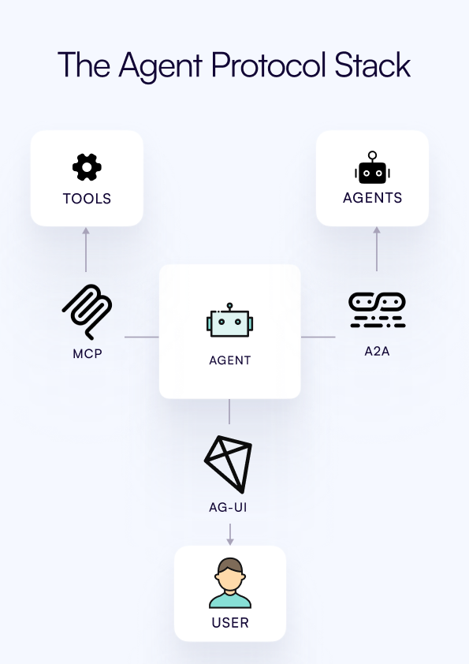

<em class="lead">理解 AG-UI 如何与 MCP 和 A2A 互补并协同工作</em>

## 智能体协议 {#agentic-protocols}

智能体生态正迅速围绕一族开放且互补的协议组织起来——每个协议针对交互中一个不同的层次。AG-UI 已成为 AI 协议版图中的第三根支柱：

你可以通过 **AG-UI**、**MCP** 和 **A2A** 直接将应用连接到智能体。

- **MCP**（Model Context Protocol）将智能体连接到工具与上下文——但这些工具自身也正在变得具备智能体特性。
- **A2A**（Agent to Agent）将智能体连接到其他智能体。
- **AG-UI（Agent–User Interaction）** 将智能体连接到用户（通过面向用户的应用）。
    
    你可以把 AG-UI 看作**“包罗万象”协议**——它源自自下而上的真实需求，用于构建一流的智能体应用。
    

这三种智能体协议相互补充，各自有着不同的技术目标；单个智能体可以、而且经常同时使用全部三种协议。

## AG-UI 与 MCP 和 A2A 的握手 {#agui-handshakes-with-mcp-and-a2a}

AG-UI 贡献者最近加入了握手支持，使 AG-UI 能够通过 MCP 和 A2A 协议“代表”智能体对外呈现，从而让 AG-UI 客户端应用与库能够无缝使用支持 MCP 和 A2A 的智能体。

AG-UI 的使命是支持现代智能体应用所需的全部构建模块。

## 生成式 UI 规范 {#generative-ui-specs}

最近发布了若干[生成式 UI 规范](./concepts/generative-ui-specs.md)（包括 MCP-UI、Open JSON UI 和 A2UI），它们允许智能体通过交互协议交付 UI 组件。AG-UI 与所有这些规范兼容。访问我们的[生成式 UI 规范页面](./concepts/generative-ui-specs.md)了解更多。
