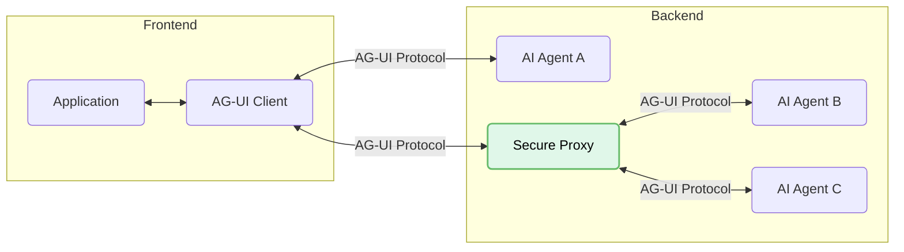

<em class="lead">理解 AG-UI 如何把前端应用连接到 AI 智能体</em>

Agent User Interaction Protocol (AG-UI) 构建在灵活的事件驱动架构之上，使前端应用与 AI 智能体之间能够进行无缝、高效的通信。本文档介绍其核心架构组件与概念。

## 设计原则 {#design-principles}

AG-UI 被设计得轻量且尽可能不预设倾向，因此易于与各种智能体实现集成。该协议的灵活性来自其简单的要求：

1. **事件驱动通信**：智能体需要在执行期间发出 16 种标准化事件类型中的任意一种，形成客户端可以处理的更新流。

2. **双向交互**：智能体接受来自用户的输入，从而支持人与 AI 无缝协作的协同式工作流。

该协议包含一个内置的中间件层，它从两个关键方面最大化兼容性：

- **灵活的事件结构**：事件不必与 AG-UI 的格式完全一致——它们只需要与 AG-UI 兼容。这使现有的智能体框架能够以最小的代价适配其原生事件格式。

- **传输无关**：AG-UI 不强制规定事件的投递方式，支持多种传输机制，包括 Server-Sent Events (SSE)、webhook、WebSocket 等。这种灵活性让开发者可以选择最契合自身架构的传输。

这种务实的方式使 AG-UI 易于采用，无需对现有智能体实现或前端应用做重大改动。

## 架构总览 {#architectural-overview}

AG-UI 遵循客户端-服务器架构，标准化智能体与应用之间的通信：



- **Application**：面向用户的应用（即聊天或任何启用了 AI 的应用）。
- **AG-UI Client**：通用通信客户端，例如 `HttpAgent`，或用于连接既有协议的专用客户端。
- **Agents**：处理后端请求并生成流式响应的 AI 智能体。
- **Secure Proxy**：提供额外能力并充当安全代理的后端服务。

## 核心组件 {#core-components}

### 协议层 {#protocol-layer}

AG-UI 的协议层为智能体通信提供了灵活的基础。

- **通用兼容性**：通过实现 `run(input: RunAgentInput) -> Observable<BaseEvent>` 即可连接到任何协议

该协议的首要抽象使应用能够运行智能体并接收事件流：

{/* prettier-ignore */}
```typescript
// Core agent execution interface
type RunAgent = () => Observable<BaseEvent>

class MyAgent extends AbstractAgent {
  run(input: RunAgentInput): RunAgent {
    const { threadId, runId } = input
    return () =>
      from([
        { type: EventType.RUN_STARTED, threadId, runId },
        {
          type: EventType.MESSAGES_SNAPSHOT,
          messages: [
            { id: "msg_1", role: "assistant", content: "Hello, world!" }
          ],
        },
        { type: EventType.RUN_FINISHED, threadId, runId },
      ])
  }
}
```

### 标准 HTTP 客户端 {#standard-http-client}

AG-UI 提供了一个标准 HTTP 客户端 `HttpAgent`，可用于连接任何接受正文类型为 `RunAgentInput` 的 POST 请求、并发送 `BaseEvent` 对象流的端点。

`HttpAgent` 支持以下传输：

- **HTTP SSE (Server-Sent Events)**

  - 基于文本的流式传输，兼容性广
  - 易于阅读和调试

- **HTTP 二进制协议**
  - 高性能且节省空间的自定义传输
  - 面向生产环境的健壮二进制序列化

### 消息类型 {#message-types}

AG-UI 为智能体通信的不同方面定义了几类事件：

- **生命周期事件**

  - `RUN_STARTED`、`RUN_FINISHED`、`RUN_ERROR`
  - `STEP_STARTED`、`STEP_FINISHED`

- **文本消息事件**

  - `TEXT_MESSAGE_START`、`TEXT_MESSAGE_CONTENT`、`TEXT_MESSAGE_END`

- **工具调用事件**

  - `TOOL_CALL_START`、`TOOL_CALL_ARGS`、`TOOL_CALL_END`

- **状态管理事件**

  - `STATE_SNAPSHOT`、`STATE_DELTA`、`MESSAGES_SNAPSHOT`

- **特殊事件**
  - `RAW`、`CUSTOM`

## 运行智能体 {#running-agents}

要运行智能体，你创建一个客户端实例并执行它：

```typescript
// Create an HTTP agent client
const agent = new HttpAgent({
  url: "https://your-agent-endpoint.com/agent",
  agentId: "unique-agent-id",
  threadId: "conversation-thread"
});

// Start the agent and handle events
agent.runAgent({
  tools: [...],
  context: [...]
}).subscribe({
  next: (event) => {
    // Handle different event types
    switch(event.type) {
      case EventType.TEXT_MESSAGE_CONTENT:
        // Update UI with new content
        break;
      // Handle other event types
    }
  },
  error: (error) => console.error("Agent error:", error),
  complete: () => console.log("Agent run complete")
});
```

## 状态管理 {#state-management}

AG-UI 通过专门的事件提供高效的状态管理：

- `STATE_SNAPSHOT`：某一时间点的完整状态表示
- `STATE_DELTA`：使用 JSON Patch 格式（RFC 6902）的增量状态变更
- `MESSAGES_SNAPSHOT`：完整的会话历史

这些事件以最少的数据传输实现高效的客户端侧状态管理。

## 工具与移交 {#tools-and-handoff}

AG-UI 通过标准化事件支持智能体之间的移交和工具使用：

- 工具定义通过 `runAgent` 参数传入
- 工具调用以 `TOOL_CALL_START` → `TOOL_CALL_ARGS` → `TOOL_CALL_END` 事件的序列流式传输
- 智能体可以移交给其他智能体，同时保持上下文的连续性

## 事件 {#events}

AG-UI 中的所有通信都基于有类型的事件。每个事件都继承自 `BaseEvent`：

```typescript
interface BaseEvent {
  type: EventType
  timestamp?: number
  rawEvent?: any
}
```

事件经过严格的类型化和校验，确保组件之间可靠的通信。
