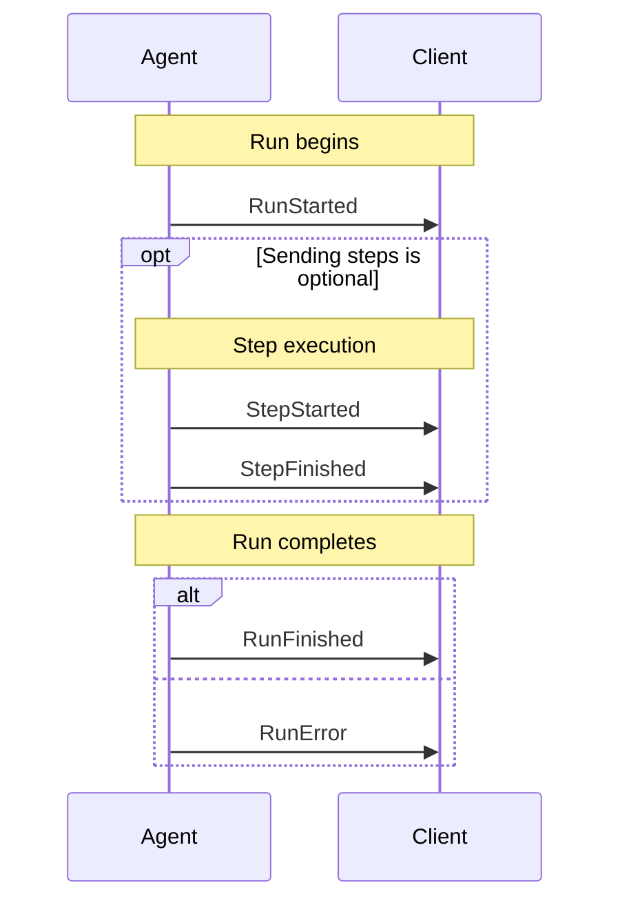
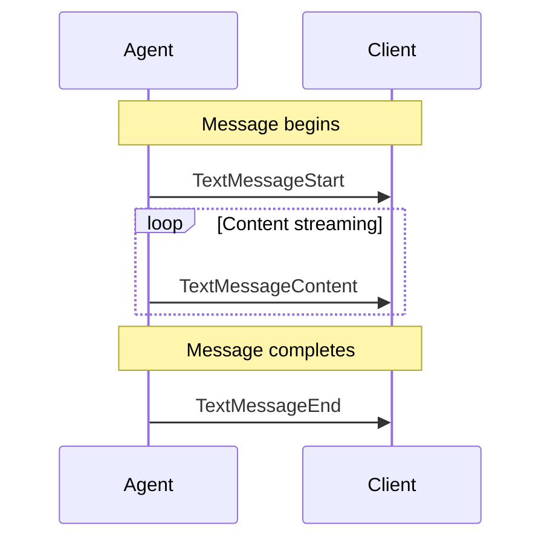
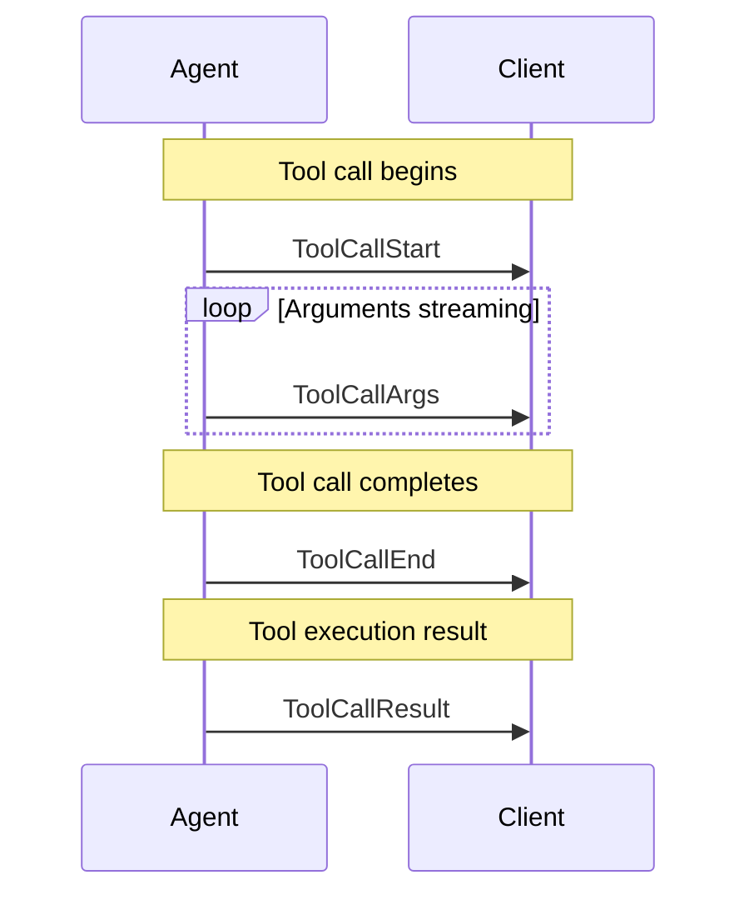
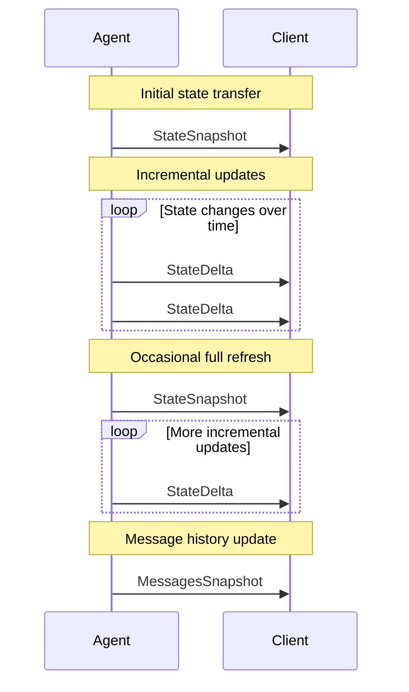
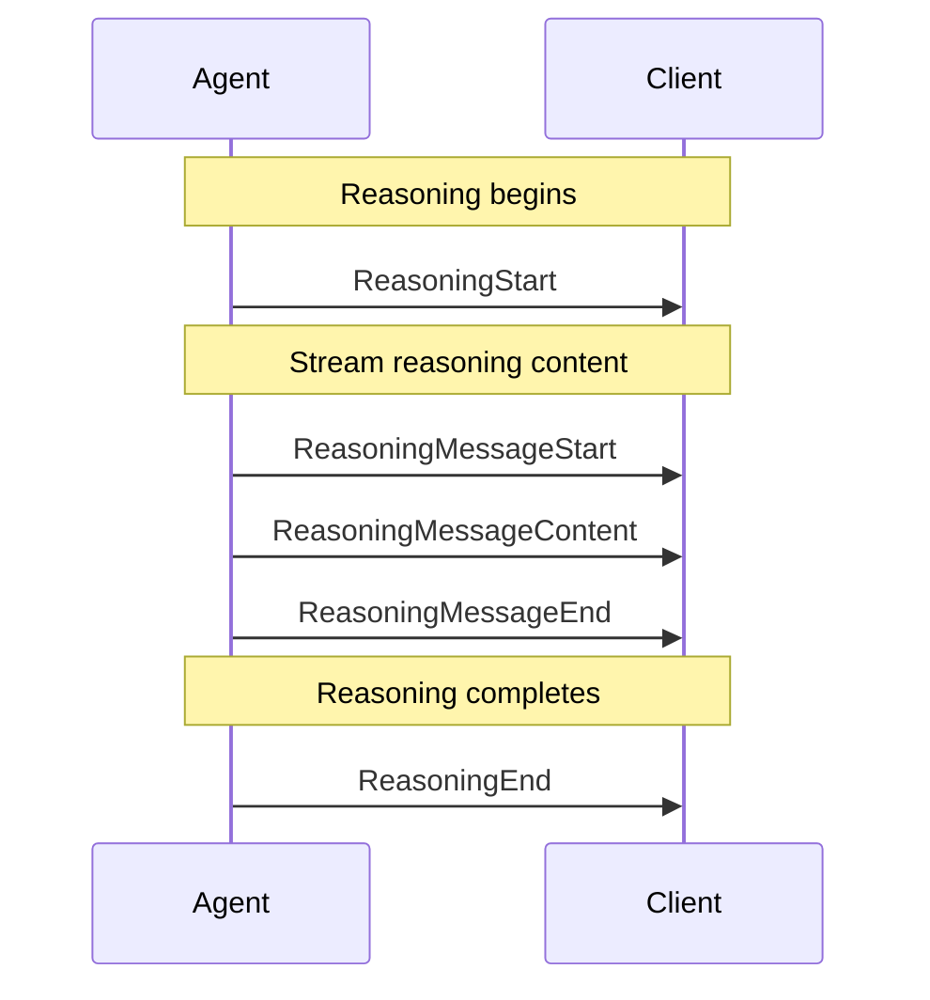
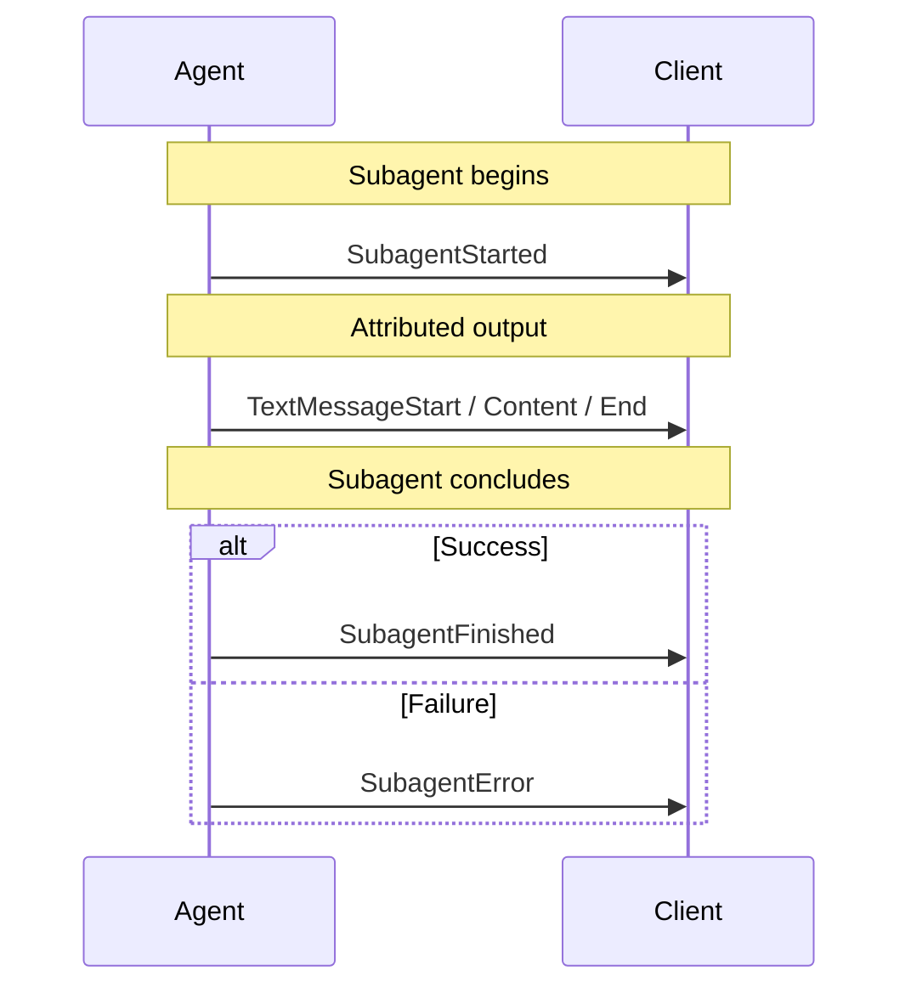

<em class="lead">理解 Agent User Interaction Protocol 中的事件</em>

# 事件 {#events}

Agent User Interaction Protocol 采用基于事件的流式架构。
事件是智能体与前端之间通信的基本单元，
支撑实时、结构化的交互。

## 事件类型概览 {#event-types-overview}

协议中的事件按用途分类：

| 类别                    | 描述                                    |
| ----------------------- | --------------------------------------- |
| Lifecycle Events        | 监控智能体运行的进展                    |
| Text Message Events     | 处理流式文本内容                        |
| Tool Call Events        | 管理智能体发起的工具执行                |
| State Management Events | 在智能体与 UI 之间同步状态              |
| Activity Events         | 表示正在进行中的活动进度                |
| Subagent Events         | 跟踪子智能体并归属其输出                |
| Special Events          | 支持自定义功能                          |
| Draft Events            | 开发中的提案事件                        |

## 基础事件属性 {#base-event-properties}

所有事件共享一组通用的基础属性：

| 属性        | 描述                                                             |
| ----------- | ---------------------------------------------------------------- |
| `type`      | 具体的事件类型标识符                                             |
| `timestamp` | 可选的时间戳，指示事件的创建时间                                 |
| `rawEvent`  | 可选字段，包含转换前的原始事件数据                               |
| `metadata`  | 附加到事件上的可选额外信息                                       |

### 元数据 {#metadata}

`metadata` 是一个可选的、按 key 开放的对象，用于向事件附加额外信息 —
token 用量、trace id、finish reason。它只在基础事件上声明一次，
因此每种事件类型都会携带它。

消费方会把事件的元数据逐个 key 合并进该事件所构建的消息中，
后写入者胜出。正因如此，生产方可以在消息的最后一个事件上发送
token 用量，而不必提前知道它。

完整规则见 [元数据](./metadata.md)：保留的 `ag-ui` key、
哪些事件会合并哪些不会、工具调用如何携带各自的元数据，
以及该对象在不同传输上的行为。

大多数事件还接受一个可选的 `subagentRunId`，用于标识产生该事件的
子智能体。不带该字段的事件属于父智能体。
参见 [子智能体](./subagents.md)。

## 生命周期事件 {#lifecycle-events}

这些事件表示智能体运行的生命周期。典型的智能体运行
遵循可预测的模式：以 `RunStarted` 事件开始，其间可能包含
多组可选的 `StepStarted`/`StepFinished` 对，并以
`RunFinished` 事件（成功）或 `RunError` 事件（失败）结束。

生命周期事件为智能体运行提供了关键的结构，使前端能够
跟踪进度、恰当地管理 UI 状态并优雅地处理错误。
它们建立了一致的框架，用于理解操作何时开始与
结束，从而实现加载指示器、进度
跟踪和错误恢复机制等功能。

`RunStarted` 以及 `RunFinished` 或 `RunError` 中的一个是必需的，
它们构成智能体运行的边界。步骤事件是可选的，在一次运行中可出现
多次，从而实现结构化、可观测的进度
跟踪。

### RunStarted {#runstarted}

表示智能体运行的开始。

`RunStarted` 事件是智能体开始处理请求时发出的第一个事件。
它建立一个由唯一 `runId` 标识的新执行上下文。该事件可作为
标记，供前端初始化进度指示器或加载状态等 UI
元素。它还提供关键标识符，可用于将后续事件关联到这次特定的
运行。

| 属性          | 描述                                                                                                                                                    |
| ------------- | -------------------------------------------------------------------------------------------------------------------------------------------------------------- |
| `threadId`    | 会话线程的 ID                                                                                                                                  |
| `runId`       | 智能体运行的 ID                                                                                                                                            |
| `parentRunId` | （可选）用于分支/时间旅行的谱系指针。若存在，指向同一会话中的先前运行，形成类似 git 的仅追加日志            |
| `input`       | （可选）本次运行发送给智能体的确切输入载荷。可省略历史中已存在的消息；compactEvents() 会将其规范化 |

### RunFinished {#runfinished}

表示智能体运行的结束。每次运行都以 `RunFinished`
或 `RunError` 终止。

`RunFinished` 有一个可选的 `outcome` 判别联合：

- **省略** — 尚未采用中断感知生命周期的旧式
  生产方。视为正常完成。
- `outcome: { type: "success" }` — 运行正常完成。为向后兼容，
  可选的 `result` 保留在事件的根层级。
- `outcome: { type: "interrupt", interrupts: [...] }` — 运行因等待人工
  输入而暂停。非空的 `interrupts` 数组位于 outcome 变体内部。
  客户端通过启动一次新的运行来恢复，其 `RunAgentInput` 包含一个 `resume`
  数组，逐一处理每个未关闭的中断。

!!! note
    完整的中断生命周期 — `Interrupt` 类型、契约规则、错误
      处理、reason 分类体系以及完整示例 — 参见
      [中断](./interrupts.md)。

### RunError {#runerror}

表示智能体运行期间发生的错误。

`RunError` 事件表示智能体遇到了无法恢复的错误，
导致运行提前终止。该事件提供出错
信息，使前端能够显示相应的错误消息，并可能提供恢复
选项。在 `RunError` 事件之后，本次运行中不会再有
进一步的处理发生。

| 属性      | 描述                |
| --------- | ------------------- |
| `message` | 错误消息            |
| `code`    | 可选的错误码        |

### StepStarted {#stepstarted}

表示智能体运行中某个步骤的开始。

`StepStarted` 事件表示智能体开始处理某个特定的子任务
或阶段。步骤提供了对智能体进度的细粒度可见性，
使 UI 中能够进行更精确的跟踪与反馈。步骤是
可选的，但对于适合拆分为可观测阶段的复杂操作，
强烈建议使用。`stepName` 可以是当前正在执行的节点
或函数的名称。

| 属性       | 描述             |
| ---------- | ---------------- |
| `stepName` | 步骤的名称       |

### StepFinished {#stepfinished}

表示智能体运行中某个步骤的完成。

`StepFinished` 事件表示智能体已完成某个特定的
子任务或阶段。与对应的 `StepStarted` 事件配对时，它
为一项独立的工作单元建立了有界的上下文。前端可以使用这些
事件更新进度指示器、显示完成动画，或展示
该步骤特有的结果。`stepName` 必须与对应的
`StepStarted` 事件匹配，才能正确配对步骤的开始与结束。

| 属性       | 描述             |
| ---------- | ---------------- |
| `stepName` | 步骤的名称       |

## 文本消息事件 {#text-message-events}

这些事件表示会话中文本消息的生命周期。文本
消息事件遵循流式模式，内容以增量方式送达。
一条消息以 `TextMessageStart` 事件开始，随后是一个
或多个 `TextMessageContent` 事件，在文本块可用时即时送达，
最后以 `TextMessageEnd` 事件结束。

这种流式方式使消息内容在生成时即可实时显示，
相比等待整条消息完成后再显示任何内容，带来更灵敏的
用户体验。

每个 `TextMessageContent` 事件都包含一个 `delta` 字段，
携带一块文本。前端应按接收顺序拼接这些 delta，以
构建完整的消息。`messageId` 属性串联所有相关
事件，使前端能够将内容块关联到正确的
消息。

### TextMessageStart {#textmessagestart}

表示文本消息的开始。

`TextMessageStart` 事件在会话中初始化一条新的文本消息。
它建立一个唯一的 `messageId`，供后续的
内容块和结束事件引用。该事件让前端可以为即将到来的消息
准备 UI，例如创建一个带加载
指示器的新消息气泡。`role` 属性标识该消息来自
assistant 还是会话中的其他参与者。

| 属性        | 描述                                                                            |
| ----------- | ------------------------------------------------------------------------------- |
| `messageId` | 消息的唯一标识符                                                                |
| `role`      | 消息发送者的角色（"developer"、"system"、"assistant"、"user"、"tool"）          |

### TextMessageContent {#textmessagecontent}

表示流式文本消息中的一块内容。

`TextMessageContent` 事件在消息文本的各部分可用时
增量送达。每个事件在 `delta`
属性中包含一小块文本，应追加到此前接收到的块之后。这些事件的流式
特性使内容能够实时显示，带来更灵敏、更流畅的
用户体验。实现应高效处理这些
事件，以确保文本渲染顺畅，不出现可见的延迟或
闪烁。

| 属性        | 描述                                   |
| ----------- | -------------------------------------- |
| `messageId` | 与 `TextMessageStart` 中的 ID 匹配     |
| `delta`     | 文本内容块（非空）                     |

### TextMessageEnd {#textmessageend}

表示文本消息的结束。

`TextMessageEnd` 事件标志一条流式文本消息的完成。
收到该事件后，前端即知消息已完整，
不会再有内容追加。这使 UI 可以完成渲染、
移除加载指示器，并可能触发消息完成后应执行的
动作，例如启用回复控件或执行
自动滚动以确保完整消息可见。

| 属性        | 描述                                   |
| ----------- | -------------------------------------- |
| `messageId` | 与 `TextMessageStart` 中的 ID 匹配     |

### TextMessageChunk {#textmessagechunk}

便捷事件，会自动展开为 Start → Content → End。

`TextMessageChunk` 事件允许省略显式的 `TextMessageStart` 和
`TextMessageEnd` 事件。客户端流转换器会把 chunk 展开为
标准的三元组：

- 一条消息的第一个 chunk 必须包含 `messageId`，并会发出
  `TextMessageStart`（未提供时 role 默认为 `assistant`）。
- 每个带有 `delta` 的 chunk 会为当前
  `messageId` 发出一个 `TextMessageContent`。
- 当流切换到新的 message ID 或流结束时，
  会自动发出 `TextMessageEnd`。

| 属性        | 描述                                                                                 |
| ----------- | ------------------------------------------------------------------------------------ |
| `messageId` | 消息的可选唯一标识符；在消息的第一个 chunk 上为必需                                  |
| `role`      | 发送者的可选角色（"developer"、"system"、"assistant"、"user"）                       |
| `delta`     | 消息的可选文本内容                                                                   |

## 工具调用事件 {#tool-call-events}

这些事件表示智能体发起的工具调用的生命周期。工具调用
遵循与文本消息类似的流式模式。当智能体需要使用
工具时，它会发出 `ToolCallStart` 事件，随后是一个或多个 `ToolCallArgs`
事件，流式传输传给该工具的参数，最后以
`ToolCallEnd` 事件结束。

这种流式方式让前端可以实时展示工具执行，
使智能体的行为透明，并即时反馈正在调用
哪些工具、传入什么参数。

每个 `ToolCallArgs` 事件都包含一个 `delta` 字段，携带一部分
参数。前端应按接收顺序拼接这些 delta，以
构建完整的参数对象。`toolCallId` 属性串联所有
相关事件，使前端能够将参数块关联到
正确的工具调用。

### ToolCallStart {#toolcallstart}

表示工具调用的开始。

`ToolCallStart` 事件表示智能体正在调用某个工具以执行
特定功能。该事件提供被调用工具的名称，并
建立一个唯一的 `toolCallId`，供本次工具调用的后续事件
引用。前端可以用该事件向用户展示工具的使用情况，
例如显示某个操作正在进行的通知。可选的
`parentMessageId` 可将该工具调用关联到会话中的某条具体消息，
为工具的使用原因提供上下文。

| 属性              | 描述                                |
| ----------------- | ----------------------------------- |
| `toolCallId`      | 工具调用的唯一标识符                |
| `toolCallName`    | 被调用工具的名称                    |
| `parentMessageId` | 可选的父消息 ID                     |

### ToolCallArgs {#toolcallargs}

表示工具调用的一部分参数数据。

`ToolCallArgs` 事件在工具参数各部分可用时
增量送达。每个事件在
`delta` 属性中包含一段参数数据。这些 delta 通常是 JSON 片段，
组合起来构成该工具的完整参数对象。对于
完整参数需要较长时间才能构造完成的复杂工具调用，流式传输参数尤其
有价值。前端可以逐步向用户展示这些参数，
让人清楚了解究竟向工具传入了哪些参数。

| 属性         | 描述                                |
| ------------ | ----------------------------------- |
| `toolCallId` | 与 `ToolCallStart` 中的 ID 匹配     |
| `delta`      | 参数数据块                          |

### ToolCallEnd {#toolcallend}

表示工具调用的结束。

`ToolCallEnd` 事件标志一次工具调用的完成。收到
该事件后，前端即知所有参数已传输完毕，
工具执行正在进行或已完成。这使 UI 可以完成工具
调用的展示，并为可能出现的结果做好准备。在工具执行
结果单独返回的系统中，该事件表示智能体已
完成对工具及其参数的指定，正在等待或已
收到结果。

| 属性         | 描述                                |
| ------------ | ----------------------------------- |
| `toolCallId` | 与 `ToolCallStart` 中的 ID 匹配     |

### ToolCallResult {#toolcallresult}

提供工具调用执行的结果。

`ToolCallResult` 事件送达此前由智能体调用的工具的
输出或结果。该事件在系统执行完工具之后
发送，包含工具实际产生的输出。
与工具调用声明（start、args、end）的流式模式不同，
结果以完整单元送达，因为工具执行通常会产生
完整的输出。前端可以用该事件向用户展示工具结果、
将其追加到会话历史，或根据工具的输出触发后续
动作。

| 属性         | 描述                                                        |
| ------------ | ----------------------------------------------------------- |
| `messageId`  | 该结果所属会话消息的 ID                                     |
| `toolCallId` | 与对应 `ToolCallStart` 事件中的 ID 匹配                     |
| `content`    | 工具执行产生的实际结果/输出内容                             |
| `role`       | 可选的角色标识符，工具结果通常为 "tool"                     |

### ToolCallChunk {#toolcallchunk}

便捷事件，会自动展开为 Start → Args → End。

`ToolCallChunk` 事件允许省略显式的 `ToolCallStart` 和
`ToolCallEnd` 事件。客户端流转换器会把 chunk 展开为
标准的三元组：

- 一次工具调用的第一个 chunk 必须包含 `toolCallId` 和 `toolCallName`，并
  会发出 `ToolCallStart`（同时透传任何 `parentMessageId`）。
- 每个带有 `delta` 的 chunk 会为当前 `toolCallId` 发出一个 `ToolCallArgs`。
- 当流切换到新的
  `toolCallId` 或流结束时，会自动发出 `ToolCallEnd`。

| 属性              | 描述                                                                 |
| ----------------- | -------------------------------------------------------------------- |
| `toolCallId`      | 在后续 chunk 上可选；在工具调用的第一个 chunk 上为必需               |
| `toolCallName`    | 在后续 chunk 上可选；在工具调用的第一个 chunk 上为必需               |
| `parentMessageId` | 可选的父消息 ID                                                      |
| `delta`           | 可选的参数数据块（通常是 JSON 片段）                                 |

## 状态管理事件 {#state-management-events}

这些事件用于管理智能体状态并与前端同步。协议中的
状态管理遵循高效的快照-增量模式：完整的
状态快照在初始时或不频繁地发送，而
增量更新（delta）用于持续发生的变化。

这种方式同时兼顾完整性与效率：快照确保
前端拥有完整的状态上下文，而 delta 则把频繁更新的数据传输降到最低。
二者结合，使前端无需多余的数据传输即可维护智能体状态的
准确表示。

快照与 delta 的结合使前端能够高效跟踪
智能体状态的变化，同时保证一致性。快照作为
同步点，将状态重置到已知基线，而 delta
则在快照之间提供轻量的更新。

### StateSnapshot {#statesnapshot}

提供智能体状态的完整快照。

`StateSnapshot` 事件送达智能体当前状态的完整
表示。该事件通常在交互开始时或
需要同步时发送。它包含前端相关的所有状态
变量，使前端能够完全重建其内部表示。
前端应以该快照的内容替换现有的状态模型，
而不是试图将其与先前的状态合并。

| 属性       | 描述                    |
| ---------- | ----------------------- |
| `snapshot` | 完整的状态快照          |

### StateDelta {#statedelta}

使用 JSON Patch 提供智能体状态的局部更新。

`StateDelta` 事件以 JSON Patch 操作的形式（如 RFC 6902
所定义）包含对智能体状态的增量更新。每个 delta 表示
要应用到当前状态模型上的具体变更。这种方式
节省带宽，只发送发生变化的部分而非整个状态。
前端应按顺序应用这些 patch，以维护准确的状态
表示。如果前端在应用 patch 后检测到不一致，它
可以请求一份新的 `StateSnapshot`。

| 属性     | 描述                                      |
| -------- | ----------------------------------------- |
| `delta`  | JSON Patch 操作数组（RFC 6902）           |

### MessagesSnapshot {#messagessnapshot}

提供会话中所有消息的快照。

`MessagesSnapshot` 事件送达当前会话中完整的消息
历史。与通用的状态快照不同，它专门
聚焦于会话记录。该事件适用于
初始化聊天历史、在连接中断后同步，或
在用户加入进行中的会话时提供完整视图。
前端应使用它来建立或刷新展示给用户的
会话上下文。

| 属性       | 描述                     |
| ---------- | ------------------------ |
| `messages` | 消息对象数组             |

在 `MessagesSnapshot` 中，`activity` 和 `reasoning` 消息是全有或
全无的。如果快照携带了该角色的任何消息，那么它就是
该角色的完整集合：其中重复的条目会替换客户端的
副本，而被省略的条目会被移除。如果快照没有携带任何
该角色的消息，则表示快照对该角色不作任何说明，客户端保留
已有的消息。

这两种角色默认都在客户端侧，因此省略它们是安全的。活动
消息永远不会回传给智能体 — 它们会被从 `RunAgentInput`
中剥离 — 而推理通常只以流式的 `Reasoning` 事件形式存在。
两者都不跟踪的后端只需在快照中省略它们，客户端
持有的内容不会丢失。

## 活动事件 {#activity-events}

活动事件暴露聊天消息之间发生的、结构化的进行中活动
更新。它们遵循与状态系统相同的快照/增量
模式，使 UI 能够立即渲染完整的活动视图，
并在新信息到达时增量更新。

活动消息与其他所有消息占用同一 id 空间，因此其
`messageId` 不得被文本或推理消息复用，反之亦然。
它们携带的 `content` 形态不同 — 活动为结构化对象，
文本和推理为字符串 — 因此共享 id 没有一致的
含义。客户端若收到一条文本或推理消息，其 id 已被
某条活动消息占用，应保留该活动消息不动，而不是
将其覆盖。

### ActivitySnapshot {#activitysnapshot}

送达活动消息的完整快照。

| 属性           | 描述                                                                                          |
| -------------- | --------------------------------------------------------------------------------------------- |
| `messageId`    | 该事件所更新的 `ActivityMessage` 的标识符                                                     |
| `activityType` | 活动判别字段（例如 `"PLAN"`、`"SEARCH"`）                                                     |
| `content`      | 表示完整活动状态的结构化 JSON 载荷                                                            |
| `replace`      | 可选。默认为 `true`。当为 `false` 时，若消息已存在则忽略该快照                                 |

前端应创建一条新的 `ActivityMessage`，或用快照提供的载荷
替换已有的那条。

### ActivityDelta {#activitydelta}

使用 JSON Patch 操作对已有活动应用增量更新。

| 属性           | 描述                                                                     |
| -------------- | ------------------------------------------------------------------------ |
| `messageId`    | 目标活动消息的标识符                                                     |
| `activityType` | 活动判别字段（与最近一次快照的值一致）                                   |
| `patch`        | 要应用到活动数据上的 RFC 6902 JSON Patch 操作数组                        |

活动 delta 应按顺序应用到此前已同步的
活动内容上。如果应用检测到偏差，它可以请求或发出
新的 `ActivitySnapshot` 以重新同步。

## 特殊事件 {#special-events}

特殊事件为协议提供了灵活性，支持
系统特有的功能以及与外部系统的集成。这些
事件不遵循其他事件类型的标准生命周期或流式模式，
而是服务于专门用途。

### Raw {#raw}

用于透传来自外部系统的事件。

`Raw` 事件充当容器的角色，用于承载来自外部系统
或来源、本身并不遵循 Agent UI Protocol 的事件。该事件类型
通过将其他基于事件的系统的事件包装为标准化格式，
实现互操作性。被包裹的事件数据以原始形式保存在
`event` 属性中，而可选的 `source` 属性
标识其来源系统。前端可以利用这些信息恰当地处理
外部事件，既可以自行处理，也可以
委派给系统特有的处理器。

| 属性     | 描述                       |
| -------- | -------------------------- |
| `event`  | 原始事件数据               |
| `source` | 可选的来源标识符           |

### Custom {#custom}

用于应用特定的自定义事件。

`Custom` 事件提供了一种扩展机制，用于实现
标准事件类型未覆盖的功能。与作为
透传容器的 `Raw` 事件不同，`Custom` 事件明确属于协议的一部分，
但语义由应用定义。`name` 属性标识具体的
自定义事件类型，`value` 属性包含关联的数据。该
机制允许在不修改正式规范的情况下扩展协议。团队应
记录其自定义事件，以确保前端与智能体之间实现
一致。

| 属性     | 描述                            |
| -------- | ------------------------------- |
| `name`   | 自定义事件的名称                |
| `value`  | 与该事件关联的值                |

## 推理事件 {#reasoning-events}

推理事件支持 LLM 推理的可见性与连续性，在保持
隐私的同时实现思维链推理。这些事件使智能体能够
呈现推理信号（例如摘要），并支持用于跨轮次状态
传递的加密推理条目—尤其是在 `store:false` 或零
数据保留策略下—而无需暴露原始思维链。

参见
[OpenAI ZTR 文档](https://developers.openai.com/cookbook/examples/responses_api/reasoning_items/#encrypted-reasoning-items)、
[OpenAI store 参数文档](https://platform.openai.com/docs/api-reference/responses/create#responses_create-store)
以及
[Gemini Thought Signatures](https://ai.google.dev/gemini-api/docs/thought-signatures)，
了解启发了本设计的加密推理条目这一底层概念。

参见 [推理](./reasoning.md) 获取完整文档，包括
隐私考量、合规指导以及实现示例。

### ReasoningStart {#reasoningstart}

标记推理的开始。

`ReasoningStart` 事件表示智能体开始一个推理
过程。它建立一个由唯一 `messageId` 标识的推理上下文。

| 属性        | 描述                                |
| ----------- | ----------------------------------- |
| `messageId` | 本次推理的唯一标识符                |

### ReasoningMessageStart {#reasoningmessagestart}

表示推理消息的开始。

`ReasoningMessageStart` 事件开始一条流式推理消息。该
消息将包含应展示给用户的、智能体推理的可见部分
（例如摘要或部分思维链）。

| 属性        | 描述                                          |
| ----------- | --------------------------------------------- |
| `messageId` | 消息的唯一标识符                              |
| `role`      | 推理消息的角色（`"reasoning"`）               |

### ReasoningMessageContent {#reasoningmessagecontent}

表示流式推理消息中的一块内容。

`ReasoningMessageContent` 事件向客户端增量送达推理内容。
具有相同 `messageId` 的多个内容事件应
拼接起来，构成完整的可见推理。

| 属性        | 描述                                       |
| ----------- | ------------------------------------------ |
| `messageId` | 与 ReasoningMessageStart 中的 ID 匹配      |
| `delta`     | 推理内容块（非空字符串）                   |

### ReasoningMessageEnd {#reasoningmessageend}

表示推理消息的结束。

`ReasoningMessageEnd` 事件表示指定
推理消息的全部内容已发送完毕。客户端应完成所有表示
该推理消息的 UI。

| 属性        | 描述                                  |
| ----------- | ------------------------------------- |
| `messageId` | 与 ReasoningMessageStart 中的 ID 匹配 |

### ReasoningMessageChunk {#reasoningmessagechunk}

用于自动开始/关闭推理消息的便捷事件。

`ReasoningMessageChunk` 事件通过自动
管理消息生命周期来简化实现。第一个带有 `messageId` 的 chunk 会隐式开始
该消息。空的 `delta` 或下一个非推理事件会隐式关闭
该消息。

| 属性        | 描述                                                      |
| ----------- | --------------------------------------------------------- |
| `messageId` | 消息 ID（第一个事件必须非空）                             |
| `delta`     | 推理内容块（空字符串表示关闭消息）                        |

### ReasoningEnd {#reasoningend}

标记推理的结束。

`ReasoningEnd` 事件表示智能体已完成针对给定上下文
的推理过程。该事件之后，不应再期望出现具有相同
`messageId` 的推理事件。

| 属性        | 描述                                |
| ----------- | ----------------------------------- |
| `messageId` | 本次推理的唯一标识符                |

### ReasoningEncryptedValue {#reasoningencryptedvalue}

将加密的思维链推理附加到消息或工具调用上。

`ReasoningEncryptedValue` 事件携带加密的推理内容，
表示 LLM 与特定实体相关的内部思维链。
这使智能体能够跨会话轮次保留推理状态，
而不向客户端暴露原始内容。客户端以不透明的方式存储并转发
这些加密值—只有智能体（或经授权的后端）才能
解密它们。

| 属性             | 描述                                                     |
| ---------------- | -------------------------------------------------------- |
| `subtype`        | 实体类型：`"message"` 或 `"tool-call"`                   |
| `entityId`       | 该推理所属消息或工具调用的 ID                            |
| `encryptedValue` | 加密的思维链内容数据块                                   |

用例：

- **消息推理**：将加密推理附加到 `AssistantMessage` 或
  `ReasoningMessage`，以保留后续轮次的上下文
- **工具调用推理**：将加密推理附加到工具调用，以记录
  智能体为何选择特定参数或如何解读结果

## 子智能体事件 {#subagent-events}

子智能体事件让智能体能够报告它已将工作委派给子智能体，
从而使前端能够分辨哪段输出由哪个子智能体产生。没有
这些事件时，三个并发流式输出的子智能体会汇成一条无法区分的流。

归属信息由大多数其他事件上的可选 `subagentRunId` 携带；这
三个事件界定子智能体的活动范围，并为其提供一个可展示的名称。

`subagentRunId` 标识的是**一次调用**，而非可复用的子智能体
定义 — 同一个子智能体运行两次会得到两个不同的值。完整
模型（包括嵌套、并发以及客户端强制执行的规则）参见
[子智能体](./subagents.md)。

### SubagentStarted {#subagentstarted}

宣告一次新的子智能体调用。

| 属性                  | 描述                                                     |
| --------------------- | -------------------------------------------------------- |
| `subagentRunId`       | 本次调用的不透明标识符                                   |
| `name`                | 子智能体声明的名称或类型，用于展示                       |
| `description`         | 可选的人类可读描述                                       |
| `parentSubagentRunId` | 可选的外层子智能体，当子智能体嵌套时使用                 |
| `parentToolCallId`    | 可选：产生该子智能体的工具调用                           |
| `parentMessageId`     | 可选：持有该工具调用的消息                               |

### SubagentFinished {#subagentfinished}

将一次子智能体调用标记为完成。

| 属性            | 描述                                                        |
| --------------- | ----------------------------------------------------------- |
| `subagentRunId` | 与 SubagentStarted 中的 ID 匹配                             |
| `result`        | 可选的完成载荷，与 `RunFinished.result` 对应                 |
| `outcome`       | 可选的判别联合：`{ type: "success" }` 或 `{ type: "suspended", interruptIds?: string[] }`。省略表示成功（旧式解读）。`suspended` 表示子智能体在运行途中被检查点保存，等待外部输入 — 此时运行以 interrupt outcome 结束，`interruptIds` 列出那些其答复可恢复该子智能体的运行级中断。 |

### SubagentError {#subagenterror}

将一次子智能体调用标记为失败。

| 属性            | 描述                            |
| --------------- | ------------------------------- |
| `subagentRunId` | 与 SubagentStarted 中的 ID 匹配 |
| `message`       | 人类可读的错误消息              |
| `code`          | 可选的错误码                    |

!!! note
    `StateSnapshot` 和 `StateDelta` 可被归属，但对其的归属是
      **来源标记，而非所有权**：它记录该更新由哪个子智能体产生。
      状态仍以运行为作用域，带归属的快照或增量会应用到
      该运行唯一的状态文档上，与不带归属的完全一样。不存在
      按子智能体划分的状态。

## 已弃用的事件 {#deprecated-events}

!!! warning
    以下事件已弃用，将在 1.0.0 版本中移除。请改用
      对应的推理事件。

### Thinking 事件（已弃用） {#thinking-events-deprecated}

`THINKING_*` 事件已被 `REASONING_*` 事件取代：

| 已弃用的事件                    | 替代项                      |
| ------------------------------- | --------------------------- |
| `THINKING_START`                | `REASONING_START`           |
| `THINKING_END`                  | `REASONING_END`             |
| `THINKING_TEXT_MESSAGE_START`   | `REASONING_MESSAGE_START`   |
| `THINKING_TEXT_MESSAGE_CONTENT` | `REASONING_MESSAGE_CONTENT` |
| `THINKING_TEXT_MESSAGE_END`     | `REASONING_MESSAGE_END`     |

详细的迁移指导参见 [推理迁移](./reasoning.md#migration-from-thinking-events)。

## 提案事件 {#draft-events}

这些事件目前处于提案状态，在最终确定之前可能发生变化。
它们代表正在积极开发和讨论中的协议扩展
提案。

### 元事件 {#meta-events}

**草案**
[查看提案](../drafts/meta-events.md)

元事件提供独立于智能体运行的注解与信号，例如
用户反馈或外部系统事件。

#### MetaEvent {#metaevent}

一种旁路注解事件，可出现在流中的任意位置。

| 属性       | 描述                                                |
| ---------- | --------------------------------------------------- |
| `metaType` | 应用定义的类型（例如 "thumbs_up"、"tag"）           |
| `payload`  | 应用定义的载荷                                      |

### 修改的生命周期事件 {#modified-lifecycle-events}

**草案**
[查看规范](./interrupts.md)

对现有生命周期事件的扩展，以支持中断与分支。

#### RunFinished（扩展） {#runfinished-extended}

`RunFinished` 事件新增了字段，以支持中断感知的工作流。

| 属性      | 描述                                                                                                                              |
| --------- | --------------------------------------------------------------------------------------------------------------------------------- |
| `outcome` | 可选的判别联合：`{ type: "success" }` 或 `{ type: "interrupt", interrupts: [...] }`。在旧式生产方上省略。                          |
| `result`  | 可选。自由形式的完成载荷。为向后兼容旧式生产方而保留在事件根层级；可与任意 outcome 共存。                                          |

谱系与输入捕获参见 [序列化](./serialization.md)。

#### RunStarted（扩展） {#runstarted-extended}

`RunStarted` 事件新增了字段，以支持分支与输入跟踪。

| 属性          | 描述                                              |
| ------------- | ------------------------------------------------- |
| `parentRunId` | 可选：用于分支/时间旅行的父运行 ID                |
| `input`       | 可选：本次运行的确切智能体输入                    |

## 事件流模式 {#event-flow-patterns}

协议中的事件通常遵循特定的模式：

1. **Start-Content-End 模式**：用于流式内容（文本消息、
   工具调用）
   - `Start` 事件发起流
   - `Content` 事件送达数据块
   - `End` 事件表示完成

2. **Snapshot-Delta 模式**：用于状态同步
   - `Snapshot` 提供完整状态
   - `Delta` 事件提供增量更新

3. **生命周期模式**：用于监控智能体运行
   - `Started` 事件表示开始
   - `Finished`/`Error` 事件表示结束

## 实现注意事项 {#implementation-considerations}

实现事件处理器时：

- 事件应按接收顺序处理
- 具有相同 ID（例如 `messageId`、`toolCallId`）的事件属于同一条
  逻辑流
- 实现应能容忍乱序送达
- 自定义事件应遵循既有模式以保持一致
