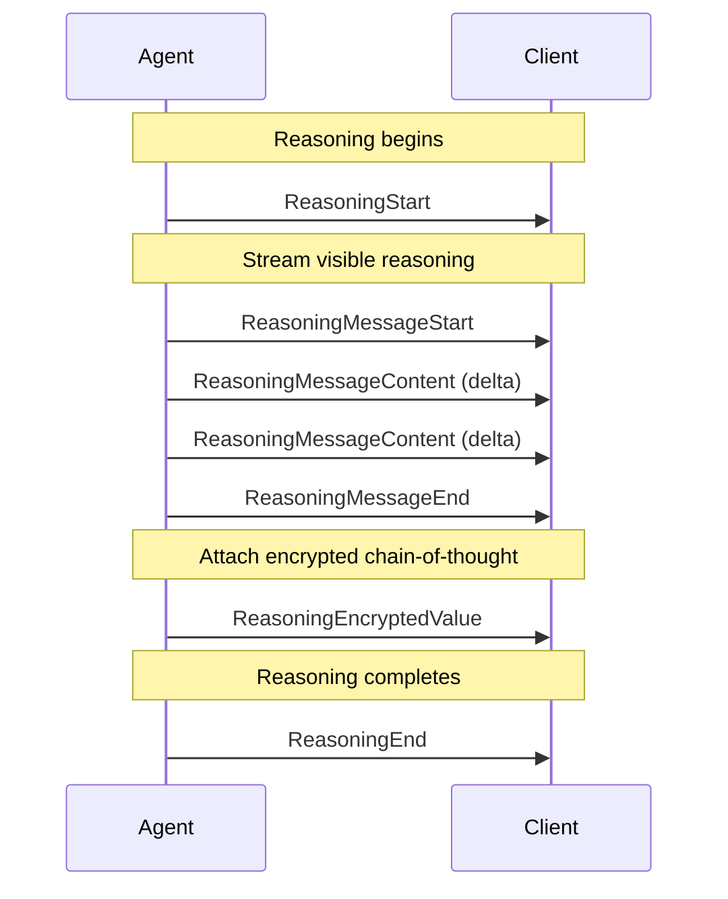

<em class="lead">AG-UI 中对 LLM 推理可见性与连续性的支持</em>

# 推理 {#reasoning}

AG-UI 为 LLM 推理提供一等支持，在保持隐私与跨对话轮次状态连续性的同时，
实现思维链可见性。

## 概述 {#overview}

现代 LLM 越来越多地使用思维链推理来提升响应质量。AG-UI 的推理支持解决三个关键挑战：

- **推理可见性**：向用户呈现推理信号（例如摘要），而不暴露原始思维链
- **状态连续性**：即使在 `store:false` 或零数据保留（ZDR）策略下，
  也使用加密的推理项在跨轮次之间保持推理上下文
- **隐私合规**：在保留推理能力的同时满足企业隐私要求

!!! tip
    与 Activity 消息不同，Reasoning 消息用于表示
      智能体的内部思考过程，出于隐私考虑可能被加密，并且
      需要在后续轮次中回传给智能体以进一步处理。

## ReasoningMessage {#reasoningmessage}

`ReasoningMessage` 类型表示消息历史中的推理内容：

```typescript
interface ReasoningMessage {
  id: string
  role: "reasoning"
  content: string // Reasoning content (visible to client)
  encryptedValue?: string // Optional encrypted reasoning for state continuity
}
```

| 属性             | 类型          | 说明                                                 |
| ---------------- | ------------- | ---------------------------------------------------- |
| `id`             | `string`      | 推理消息的唯一标识符                                 |
| `role`           | `"reasoning"` | 消息角色判别字段                                     |
| `content`        | `string`      | 对客户端可见的推理内容                               |
| `encryptedValue` | `string?`     | 用于状态连续性的加密思维链二进制数据                 |

关键特征：

- **与助手消息分离**：推理与最终响应保持区分，以避免污染会话历史
- **可流式传输**：内容通过流式事件到达
- **可选加密**：当存在 `encryptedValue` 时，它表示由客户端存储并
  不透明转发的加密思维链

## 推理事件 {#reasoning-events}

推理事件管理推理消息的生命周期。完整事件参考见
[事件](./events.md#reasoning-events)。

### 事件流 {#event-flow}

典型的推理流程遵循以下模式：



### 事件类型 {#event-types}

| 事件                      | 用途                                                          |
| ------------------------- | ------------------------------------------------------------- |
| `ReasoningStart`          | 标记推理阶段的开始                                            |
| `ReasoningMessageStart`   | 开始一条流式推理消息                                          |
| `ReasoningMessageContent` | 传递推理内容块                                                |
| `ReasoningMessageEnd`     | 完成一条推理消息                                              |
| `ReasoningMessageChunk`   | 自动管理消息生命周期的便捷事件                                |
| `ReasoningEnd`            | 标记推理完成                                                  |
| `ReasoningEncryptedValue` | 将加密思维链附加到消息或工具调用                              |

## 隐私与合规 {#privacy-and-compliance}

AG-UI 推理按隐私优先原则设计：

### 零数据保留（ZDR） {#zero-data-retention-zdr}

对于要求零数据保留的部署：

1. **加密的推理值**可以在客户端不存储可解密内容的情况下跨轮次携带状态
2. 客户端通过 `ReasoningEncryptedValue` 事件接收并不透明地转发 `encryptedValue` 二进制数据
3. 只有智能体（或经授权的后端）可以解密推理内容

### 可见性控制 {#visibility-control}

智能体控制哪些推理对用户可见：

- **完全可见**：通过 `ReasoningMessageContent` 事件流式传输完整思维链
- **仅摘要**：发出精简摘要，同时将详细推理作为加密值附加
- **隐藏**：仅使用 `ReasoningEncryptedValue` 事件，不进行可见的流式传输

### 合规考量 {#compliance-considerations}

| 要求                     | 解决方案                                                                             |
| ----------------------- | ----------------------------------------------------------------------------------- |
| GDPR 删除权              | 加密内容可以丢弃，而不丧失推理能力                                                   |
| SOC 2 数据处理           | 推理内容从不以明文形式存储在客户端                                                   |
| HIPAA 最小必要原则       | 仅暴露摘要；详细推理保持加密                                                         |
| 审计日志                 | `ReasoningStart`/`ReasoningEnd` 事件提供审计轨迹，且不暴露内容                        |

## 实现示例 {#example-implementations}

### 基本推理流程 {#basic-reasoning-flow}

一个展示可见推理的简单实现：

```typescript
// Agent emits reasoning start
yield {
  type: "REASONING_START",
  messageId: "reasoning-001",
}

// Stream visible reasoning content
yield {
  type: "REASONING_MESSAGE_START",
  messageId: "msg-123",
  role: "reasoning",
}

yield {
  type: "REASONING_MESSAGE_CONTENT",
  messageId: "msg-123",
  delta: "Let me ",
}

yield {
  type: "REASONING_MESSAGE_CONTENT",
  messageId: "msg-123",
  delta: "think through ",
}

yield {
  type: "REASONING_MESSAGE_CONTENT",
  messageId: "msg-123",
  delta: "this step ",
}

yield {
  type: "REASONING_MESSAGE_CONTENT",
  messageId: "msg-123",
  delta: "by step...",
}

yield {
  type: "REASONING_MESSAGE_END",
  messageId: "msg-123",
}

// End reasoning
yield {
  type: "REASONING_END",
  messageId: "reasoning-001",
}
```

### 用于状态连续性的加密内容 {#encrypted-content-for-state-continuity}

当需要在不暴露内容的情况下跨轮次维护推理状态时，使用
`ReasoningEncryptedValue` 事件将加密思维链附加到消息或工具调用：

```typescript
// Agent emits reasoning start
yield {
  type: "REASONING_START",
  messageId: "reasoning-002",
}

// Stream a visible summary for the user
yield {
  type: "REASONING_MESSAGE_START",
  messageId: "msg-456",
  role: "reasoning",
}

yield {
  type: "REASONING_MESSAGE_CONTENT",
  messageId: "msg-456",
  delta: "Analyzing your request...",
}

yield {
  type: "REASONING_MESSAGE_END",
  messageId: "msg-456",
}

// Attach encrypted chain-of-thought to the reasoning message
yield {
  type: "REASONING_ENCRYPTED_VALUE",
  subtype: "message",
  entityId: "msg-456",
  encryptedValue: "eyJhbGciOiJBMjU2R0NNIiwiZW5jIjoiQTI1NkdDTSJ9...",
}

yield {
  type: "REASONING_END",
  messageId: "reasoning-002",
}

// On subsequent turns, client sends back the message with encryptedValue
// which the agent can decrypt to restore reasoning context
```

### 将加密推理附加到工具调用 {#attaching-encrypted-reasoning-to-tool-calls}

你也可以将加密推理附加到工具调用，以记录智能体为何选择特定参数，
或它如何解释结果：

```typescript
// Tool call with encrypted reasoning
yield {
  type: "TOOL_CALL_START",
  toolCallId: "tool-123",
  toolCallName: "search_database",
  parentMessageId: "msg-789",
}

yield {
  type: "TOOL_CALL_ARGS",
  toolCallId: "tool-123",
  delta: '{"query": "user preferences"}',
}

yield {
  type: "TOOL_CALL_END",
  toolCallId: "tool-123",
}

// Attach encrypted reasoning explaining why this tool was called
yield {
  type: "REASONING_ENCRYPTED_VALUE",
  subtype: "tool-call",
  entityId: "tool-123",
  encryptedValue: "encrypted-reasoning-about-tool-selection...",
}
```

### 符合 ZDR 的实现 {#zdrcompliant-implementation}

对于零数据保留场景：

```typescript
// Server-side: encrypt reasoning before sending
const encryptedReasoning = await encrypt(detailedChainOfThought, secretKey)

yield {
  type: "REASONING_START",
  messageId: "reasoning-003",
}

// Only emit a high-level summary to the client
yield {
  type: "REASONING_MESSAGE_CHUNK",
  messageId: "summary-001",
  delta: "Processing your request securely...",
}

yield {
  type: "REASONING_MESSAGE_CHUNK",
  messageId: "summary-001",
  delta: "", // Empty delta closes the message
}

// Attach the encrypted chain-of-thought
yield {
  type: "REASONING_ENCRYPTED_VALUE",
  subtype: "message",
  entityId: "summary-001",
  encryptedValue: encryptedReasoning,
}

yield {
  type: "REASONING_END",
  messageId: "reasoning-003",
}

// Client stores only:
// - The encrypted blob (cannot decrypt)
// - The summary text (no sensitive details)
// Full reasoning is never persisted in plaintext
```

### 使用便捷的块事件 {#using-the-convenience-chunk-event}

`ReasoningMessageChunk` 事件通过自动管理消息生命周期简化实现：

```typescript
// First chunk with messageId starts the message automatically
yield {
  type: "REASONING_MESSAGE_CHUNK",
  messageId: "msg-789",
  delta: "Analyzing the problem space...",
}

// Subsequent chunks continue the stream
yield {
  type: "REASONING_MESSAGE_CHUNK",
  messageId: "msg-789",
  delta: " Considering multiple approaches...",
}

// Empty delta (or next non-reasoning event) closes automatically
yield {
  type: "REASONING_MESSAGE_CHUNK",
  messageId: "msg-789",
  delta: "",
}
```

## 客户端集成 {#client-integration}

### 处理推理事件 {#handling-reasoning-events}

```typescript
import { EventType, type BaseEvent } from "@ag-ui/core"

function handleEvent(event: BaseEvent) {
  switch (event.type) {
    case EventType.REASONING_START:
      // Initialize reasoning UI (e.g., "thinking" indicator)
      console.log("Agent is reasoning...")
      break

    case EventType.REASONING_MESSAGE_CONTENT:
      // Append visible reasoning to UI
      appendReasoningText(event.messageId, event.delta)
      break

    case EventType.REASONING_ENCRYPTED_VALUE:
      // Store encrypted value for the referenced entity
      if (event.subtype === "message") {
        storeMessageEncryptedValue(event.entityId, event.encryptedValue)
      } else if (event.subtype === "tool-call") {
        storeToolCallEncryptedValue(event.entityId, event.encryptedValue)
      }
      break

    case EventType.REASONING_END:
      // Finalize reasoning UI
      console.log("Reasoning complete")
      break
  }
}
```

### 回传加密推理 {#passing-encrypted-reasoning-back}

在发起后续请求时，包含已存储的加密值：

```typescript
const response = await agent.run({
  threadId: "thread-123",
  messages: [
    ...previousMessages,
    {
      id: "reasoning-002",
      role: "reasoning",
      content: "Analyzing your request...", // Visible summary
      encryptedValue: storedEncryptedBlob, // Opaque to client
    },
    {
      id: "user-msg-001",
      role: "user",
      content: "Follow up question...",
    },
  ],
})
```

## 从 Thinking 事件迁移 {#migration-from-thinking-events}

!!! warning
    `THINKING_*` 事件已废弃，并将在 1.0.0 版本中移除。
      新实现应使用 `REASONING_*` 事件。

### 已废弃的事件 {#deprecated-events}

以下事件已废弃：

| 已废弃事件                      | 替代方案                     |
| ------------------------------- | --------------------------- |
| `THINKING_START`                | `REASONING_START`           |
| `THINKING_END`                  | `REASONING_END`             |
| `THINKING_TEXT_MESSAGE_START`   | `REASONING_MESSAGE_START`   |
| `THINKING_TEXT_MESSAGE_CONTENT` | `REASONING_MESSAGE_CONTENT` |
| `THINKING_TEXT_MESSAGE_END`     | `REASONING_MESSAGE_END`     |

### 迁移步骤 {#migration-steps}

1. **更新事件类型**：将所有 `THINKING_*` 事件类型替换为对应的
   `REASONING_*` 等价物
2. **更新消息类型**：使用带 `role: "reasoning"` 的 `ReasoningMessage`，
   而不是任何 thinking 专用的消息类型
3. **添加加密值支持**：考虑使用 `ReasoningEncryptedValue`
   事件以改善隐私合规
4. **充分测试**：确保现有功能与新事件类型配合正常

### 迁移示例 {#example-migration}

迁移前（已废弃）：

```typescript
// ❌ Deprecated - do not use
yield { type: "THINKING_START", messageId: "think-001" }
yield { type: "THINKING_TEXT_MESSAGE_START", messageId: "msg-001" }
yield { type: "THINKING_TEXT_MESSAGE_CONTENT", messageId: "msg-001", delta: "..." }
yield { type: "THINKING_TEXT_MESSAGE_END", messageId: "msg-001" }
yield { type: "THINKING_END", messageId: "think-001" }
```

迁移后（当前）：

```typescript
// ✅ Current implementation
yield { type: "REASONING_START", messageId: "reasoning-001" }
yield { type: "REASONING_MESSAGE_START", messageId: "msg-001", role: "assistant" }
yield { type: "REASONING_MESSAGE_CONTENT", messageId: "msg-001", delta: "..." }
yield { type: "REASONING_MESSAGE_END", messageId: "msg-001" }
yield { type: "REASONING_END", messageId: "reasoning-001" }
```

## 最佳实践 {#best-practices}

1. **始终成对使用开始/结束事件**：每个 `ReasoningStart` 都应有
   对应的 `ReasoningEnd`
2. **对敏感推理使用加密值**：当思维链包含敏感信息时，
   使用 `ReasoningEncryptedValue` 将加密内容附加到消息或工具调用
3. **提供用户反馈**：即使推理已加密，也应发出可见摘要，
   让用户知道智能体正在工作
4. **优雅处理缺失事件**：客户端应对不完整的事件流保持韧性
5. **考虑带宽**：对于非常长的推理链，考虑只发出摘要以减少数据传输

## 相关文档 {#related-documentation}

- [事件](./events.md#reasoning-events) - 完整的事件类型参考
- [消息](./messages.md#reasoning-messages) - 消息类型文档
- [序列化](./serialization.md) - 状态连续性与谱系
