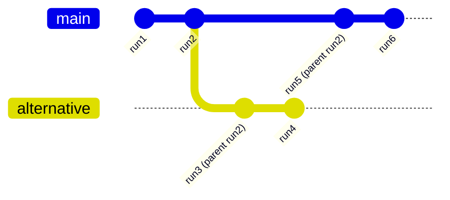

<em class="lead">在 AG-UI 中序列化事件流，用于历史恢复、分支与流压缩</em>

# 序列化 {#serialization}

AG-UI 中的序列化提供了一种标准方式，用于持久化并恢复驱动智能体–UI 会话的事件流。借助序列化后的事件流，你可以：

- 在重新加载或重连后恢复聊天历史与 UI 状态
- 接入正在运行的智能体并继续接收事件
- 从任意先前的运行创建分支（时间旅行）
- 压缩存储的历史记录以减小体积，同时不丢失含义

本页说明该模型、更新后的事件字段，以及带示例的实用模式。

## 核心概念 {#core-concepts}

- 流序列化 – 在完整事件历史与可移植表示（例如 JSON）之间相互转换，以便存入数据库、文件或日志。
- 事件压缩 – 在保留语义的前提下，把冗长的事件流缩减为快照（例如合并内容块、把增量折叠为快照）。
- 运行谱系 – 通过 `parentRunId` 跟踪会话的分支，形成类似 git 的仅追加日志，从而支持时间旅行与替代路径。

## 更新后的事件字段 {#updated-event-fields}

`RunStarted` 事件包含额外的可选字段：

```ts
type RunStartedEvent = BaseEvent & {
  type: EventType.RUN_STARTED
  threadId: string
  runId: string
  /** Parent for branching/time travel within the same thread */
  parentRunId?: string
  /** Exact agent input for this run (may omit messages already in history) */
  input?: AgentInput
}
```

这些字段支持谱系跟踪，并让实现能够精确记录传给智能体的内容，而不依赖于此前已记录的消息。

## 事件压缩 {#event-compaction}

压缩可减少事件流中的噪声，同时保持相同的可观测结果。典型实现会提供一个工具函数：

```ts
declare function compactEvents(events: BaseEvent[]): BaseEvent[]
```

常见的压缩规则包括：

- 消息流 – 把 `TEXT_MESSAGE_*` 序列合并为单条消息快照；把同一消息相邻的 `TEXT_MESSAGE_CONTENT` 拼接起来。
- 工具调用 – 把工具调用的开始/内容/结束折叠为一条紧凑记录。
- 状态 – 把连续的 `STATE_DELTA` 事件合并为单个最终的 `STATE_SNAPSHOT`，并丢弃被取代的更新。
- 运行输入归一化 – 从 `RunStarted.input.messages` 中移除在事件流更早位置已存在的消息。

## 分支与时间旅行 {#branching-and-time-travel}

在 `RunStarted` 事件上设置 `parentRunId` 会创建类似 git 的谱系。事件流变成不可变的仅追加日志，其中每次运行都可以从任意先前的运行分支出来。



优势：

- 同一份序列化日志中可包含多个分支
- 不可变的历史（仅追加）
- 可确定性地时间旅行到任意时间点

## 示例 {#examples}

### 基本序列化 {#basic-serialization}

```ts
// Serialize event stream
const events: BaseEvent[] = [...];
const serialized = JSON.stringify(events);

await storage.save(threadId, serialized);

// Restore and compact later
const restored = JSON.parse(await storage.load(threadId));
const compacted = compactEvents(restored);
```

### 事件压缩 {#event-compaction}

之前：

```ts
[
  { type: "TEXT_MESSAGE_START", messageId: "msg1", role: "user" },
  { type: "TEXT_MESSAGE_CONTENT", messageId: "msg1", delta: "Hello " },
  { type: "TEXT_MESSAGE_CONTENT", messageId: "msg1", delta: "world" },
  { type: "TEXT_MESSAGE_END", messageId: "msg1" },
  { type: "STATE_DELTA", patch: { op: "add", path: "/foo", value: 1 } },
  { type: "STATE_DELTA", patch: { op: "replace", path: "/foo", value: 2 } },
]
```

之后：

```ts
[
  {
    type: "MESSAGES_SNAPSHOT",
    messages: [{ id: "msg1", role: "user", content: "Hello world" }],
  },
  {
    type: "STATE_SNAPSHOT",
    state: { foo: 2 },
  },
]
```

### 使用 `parentRunId` 分支 {#branching-with-parentrunid}

```ts
// Original run
{
  type: "RUN_STARTED",
  threadId: "thread1",
  runId: "run1",
  input: { messages: ["Tell me about Paris"] },
}

// Branch from run1
{
  type: "RUN_STARTED",
  threadId: "thread1",
  runId: "run2",
  parentRunId: "run1",
  input: { messages: ["Actually, tell me about London instead"] },
}
```

### 归一化输入 {#normalized-input}

```ts
// First run includes full message
{
  type: "RUN_STARTED",
  runId: "run1",
  input: { messages: [{ id: "msg1", role: "user", content: "Hello" }] },
}

// Second run omits already‑present message
{
  type: "RUN_STARTED",
  runId: "run2",
  input: { messages: [{ id: "msg2", role: "user", content: "How are you?" }] },
  // msg1 omitted; it already exists in history
}
```

## 元数据 {#metadata}

事件与消息都携带一个可选的 [`metadata`](./metadata.md) 对象，它也是你所序列化内容的一部分 — 要把它与其他内容一同持久化，否则重放的事件流将缺失 token 用量、trace id 以及生产方附加上去的其他一切信息。

持久化时需要注意两点：

- **压缩会折叠它。** 折叠增量会合并它们的元数据，后写入者胜出。有关顺序方面的注意事项，参见[事件压缩](#event-compaction)与[流压缩参考](../sdk/js/client/compaction.md)。
- **二进制的表示范围比 JSON 更窄。** 在 protobuf 之上，元数据是 `google.protobuf.Struct`，因此 null、数组与嵌套对象都能保留 — 但数字是 IEEE-754 双精度浮点数，所以超过 2^53 的整数会丢失精度，而且有若干事件类型在 protobuf 中完全没有表示。JSON 能精确地往返所有内容。归档存储请优先使用 JSON。

## 实现说明 {#implementation-notes}

- 为流压缩与（反）序列化提供 SDK 辅助函数。
- 以仅追加方式存储事件流；尽可能采用增量写入。
- 持久化长历史记录时考虑使用压缩。
- 按 `threadId`、`runId` 与时间戳建立索引，以便快速检索。

## 另请参阅 {#see-also}

- 概念：[事件](./events.md)、[元数据](./metadata.md)、
  [状态管理](./state.md)
- SDK：TypeScript encoder 与核心事件类型
