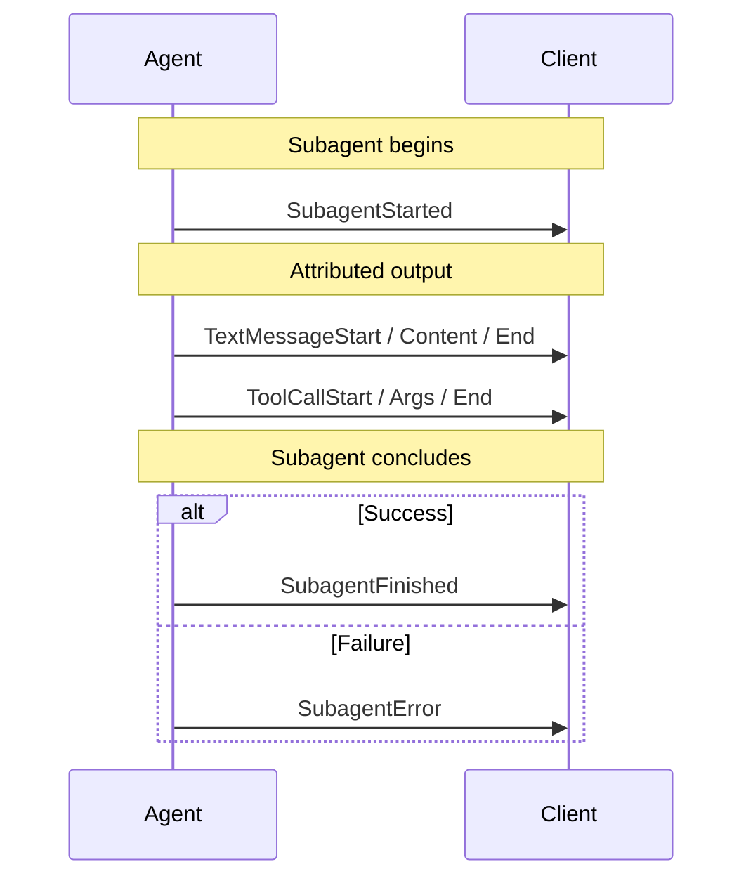

<em class="lead">把一次运行的输出归属到产出它的子智能体</em>

# 子智能体 {#subagents}

许多智能体框架允许一个智能体把工作委派给子智能体 — 一个派发研究任务的
主管，一种工具调用*即*嵌套智能体的 agents-as-tools 模式，或者一个把
子任务并行分派的规划器。

对前端而言，这一切都作为一条事件流到达。没有额外信息，就无法判断某条
消息由哪个子智能体产出，于是三个并行的研究者会渲染成一整面无从区分的文字墙。

AG-UI 的子智能体支持恰好解决这个问题，不多做别的：它把每个事件**归属**到
产出它的子智能体，并报告子智能体何时开始与停止。它不编排、不调度，也不
定义子智能体 — 那完全属于框架的职责。

## `subagentRunId` 标识的是一次调用，而非一个定义 {#subagentrunid-identifies-an-invocation-not-a-definition}

这是最需要理解、也最容易搞错的一点。

`subagentRunId` 是子智能体**一次调用的不透明句柄**。同一个子智能体运行两次，
你会得到两个不同的值。它不是可复用子智能体定义的稳定标识符，也不是一个名称。

与顶层运行的对称性使这一区别更清楚：

| 顶层                            | 子智能体                                       |
| ------------------------------------ | ---------------------------------------------- |
| `agentId` — 一个已配置、可复用的智能体 | 子智能体的 `name` — 一个可复用的子智能体类型 |
| `runId` — 一次调用的生命周期 | `subagentRunId` — 一次嵌套调用的生命周期 |

所以：

- **要**把瞬态的 UI 状态 — 一个可折叠分组、一个加载指示器、一行进度 —
  以 `subagentRunId` 为键。
- **不要**以 `subagentRunId` 持久化任何东西，并指望它在之后的运行中仍有意义，
  也不要把同一个子智能体的两次调用视为共享同一个值。当你想表达“这是哪一类
  子智能体”时，请使用 `name`。
- **一个例外**：以 `outcome: { type: "suspended" }` 结束的子智能体**可以**在
  一次恢复的运行中复用自己的 id。能够把被恢复的工作与被暂停的调用关联起来的
  生产方应当这么做，而客户端必须把稍后那个 `SubagentStarted` 视为延续
  （等待中 → 运行中），绝不能视为重复。无法关联的生产方会铸造一个新 id —
  此时客户端的等待状态通过它所应答的中断 id 来解除，而不是通过 id 复用
  （见[暂停](#suspension)）。

!!! note
    在预发布构建中，此字段名为 `subagentId`。它被改名，是因为旧名称
      暗示了一个可复用的定义。如果你所用的 `canary` 构建仍使用
      `subagentId`，其值含义相同 — 只是名称变了。

## 生命周期事件 {#lifecycle-events}

三个事件界定子智能体的活动范围。



### SubagentStarted {#subagentstarted}

宣告一次新的子智能体调用，并给它一个 UI 可以展示的名称。

| 属性              | 描述                                                     |
| --------------------- | --------------------------------------------------------------- |
| `subagentRunId`       | 本次调用的不透明 id。必填                          |
| `name`                | 子智能体声明的类型或名称，用于展示。必填      |
| `description`         | 可选的人类可读描述                             |
| `parentSubagentRunId` | 可选 — 外层子智能体，当子智能体嵌套时           |
| `parentToolCallId`    | 可选 — 产生该子智能体的工具调用              |
| `parentMessageId`     | 可选 — 持有该工具调用的消息                  |

`parentToolCallId` 和 `parentMessageId` 是为 agents-as-tools 模式而存在的。
它们让客户端把子智能体与创建它的那次调用关联起来 — 例如把子智能体的输出
渲染在工具调用卡片内部 — 而无需检查 `rawEvent`。

### SubagentFinished {#subagentfinished}

为本次运行关闭一次子智能体调用的流片段。

| 属性        | 描述                                             |
| --------------- | ------------------------------------------------------- |
| `subagentRunId` | 与 `SubagentStarted` 中的 id 匹配。必填          |
| `result`        | 可选的完成载荷，与 `RunFinished.result` 对应 |
| `outcome`       | 可选的带类型结果，与 `RunFinished.outcome` 对应：`{ type: "success" }` 或 `{ type: "suspended", interruptIds?: [...] }`。省略表示成功 |

#### 暂停 {#suspension}

子智能体可以在任务中途暂停，等待外部输入 — 例如在其内部提出的某个人工审批。
此时运行以中断结果结束（见[中断](./interrupts.md)），并且由于每个已启动的
子智能体都会在 `RunFinished` 之前关闭，被暂停的子智能体仍会发出
`SubagentFinished` — 但带有 `outcome: { type: "suspended" }`，因此 UI 可以
渲染“等待中”而不是“已完成”。`interruptIds` 指名该子智能体直接拥有的运行级
中断（每个这样的 `Interrupt` 也携带 `subagentRunId` 反向引用）；对于一个
因*后代*中断而被暂停的祖先，它可以是空的或被省略。

暂停是 `subagentRunId` 唯一可能刻意跨运行的情形 — 两侧承担的义务不同：

- **客户端必须接受**稍后一次运行中复用被暂停调用 id 的 `SubagentStarted`，
  并将其视为*延续* — 把既有分组从等待中切回运行中，绝不渲染成重复项。
- **生产方应当在其能够关联时复用该 id**：把被恢复的工作与被暂停的调用关联起来。
  LangGraph 集成就是这样做的：它的 id 派生自检查点任务身份，而后者在暂停
  之后仍然存在。复用才能让客户端无缝延续该分组。
- **无法关联的生产方铸造一个新 id**，这也是合法的。客户端的等待状态不会悬空：
  被暂停结果的 `interruptIds` 以及客户端自己发送的恢复条目，标识了哪些审批
  已获应答，因此即使没有以旧 id 到达的延续，等待标记也会据此解除。

### SubagentError {#subagenterror}

把一次子智能体调用标记为失败。

| 属性        | 描述                                    |
| --------------- | ---------------------------------------------- |
| `subagentRunId` | 与 `SubagentStarted` 中的 id 匹配。必填 |
| `message`       | 人类可读的错误消息。必填         |
| `code`          | 可选的错误码                            |

## 归属 {#attribution}

除生命周期事件之外，大多数事件都可以携带一个可选的 `subagentRunId`，
说明它们由谁产出。

没有 `subagentRunId` 的事件属于父智能体。归属是增量式的：一条从不设置该
字段的流，其行为与子智能体出现之前完全相同。

归属也可以独立成立。生产方可以给事件打标签，却从不发出
`SubagentStarted` / `SubagentFinished` — 这足以让 UI 按生产方对输出分组，
而不必承诺报告生命周期。客户端必须接受一个它从未见过宣告的标识符；
见[客户端强制执行的规则](#rules-clients-enforce)。

**可以携带归属的事件：** 文本消息族、工具调用族、活动事件、推理族、步骤事件、
状态事件，以及 `Raw`/`Custom`。

**不能携带的事件：** `RunStarted`、`RunFinished`、`RunError` — 它们描述的是
整个运行 — 以及 `MessagesSnapshot`，它改为按消息携带归属，因为一个快照
会混合来自多个生产方的消息。

### 归属是出处，而非所有权 {#attribution-is-provenance-not-ownership}

这一区别在状态事件上最为重要，因此值得明确说明。

`StateSnapshot` 和 `StateDelta` 是可归属的。对它们的归属记录的是**哪个子智能体
产出了这次更新** — 它并不意味着该子智能体拥有自己的状态。AG-UI 的状态以运行
为作用域：一次运行只有一份状态文档，带归属的快照或增量仍会应用到那一份文档上。
这个标签是你可以呈现出来的出处（“研究者更新了共享草稿板”），而不是一个独立
的作用域。

这正是归属在其他独立事件上所具有的含义。没有人会把带归属的 `Custom` 事件
读作该子智能体拥有私有的自定义事件，状态也不例外。

!!! warning
    不存在按子智能体划分的状态。如果你归属一个快照，并指望父智能体的
      状态不受影响，那不会发生 — 该快照会像任何快照一样替换运行的状态。
      如果你需要把各子智能体的数据分开，请在运行状态内使用一个不同的 key。

注意，生产方从*不*被要求必须归属状态。有些就不这么做：例如 LangGraph 集成
在子智能体活跃期间不发出状态，因为它的状态是一份共享文档，委派中途的快照
只会携带一个局部视图。那是生产方侧的一种合理选择，而非协议要求。

### 归属会转移到消息上 {#attribution-transfers-to-messages}

当一个带归属的事件创建了一条消息时，`subagentRunId` 会转移到该消息上。
这使渲染层可以按子智能体对会话分组，而无需重放事件流 — 消息本身携带
它们的来源，并且在多轮与快照之间保持它。

### 工具结果携带自己的归属 {#tool-results-carry-their-own-attribution}

`ToolCallResult` 的归属独立于它所应答的那次调用，这是刻意为之，而非疏漏：
*执行*工具调用的一方可能与*请求*它的子智能体不同。一个前端执行的工具，
或者一个代表子智能体运行调用的主管，二者产出的结果其所有者都不是调用方。
继承调用方的归属会误报这些情形，因此每个结果声明自己的归属。

## 嵌套与并发 {#nesting-and-concurrency}

子智能体可以嵌套。`SubagentStarted` 上的 `parentSubagentRunId` 把一个子级
链接到它的外层子智能体；没有父链接的子智能体直接属于该运行。

子智能体还可以**并发**运行，而正是这种情形把可用的实现与看似可行的实现区分
开来。当三个子智能体同时流式输出时，它们的事件相互交错，而归属是唯一能把它们
区分开的东西。具体来说：

- 两个子智能体可以同时拥有打开的文本消息。客户端必须分别跟踪它们，而不是
  假定同一时刻只有一条打开的消息。
- 某个子智能体的 `SubagentFinished` 只关闭该子智能体自己的打开流，绝不关闭
  兄弟或父级的流。
- 父级可能先于其子级完成。因此 `parentSubagentRunId` 可以指名一个已经完成的
  子智能体，这是合法的。

### 并发与块简写 {#concurrency-and-the-chunk-shorthand}

`TextMessageChunk` / `ToolCallChunk` / `ReasoningMessageChunk` 事件是一种
简写：由客户端合成 START/CONTENT/END 边界，而省略 id 的块意味着“与上一个
相同”。在并发之下，“上一个”只在**每个子智能体**范围内有意义 — 因此该简写
在发送方子智能体自己的流内解析，而非跨整个运行。

实际的后果是给生产方的一条规则：既不携带 id 也不携带 `subagentRunId` 的块，
若父级存在该类型的打开流，则解析到父级的打开流 — 未打标签意味着父级 —
否则解析到该类型唯一打开的流。当多个子智能体的流都可能认领它时，就没有可
据以解析的对象，客户端会拒绝它而不是猜测。**在并发流式输出时，给每个块都
加上归属**，或者重复 id。

## 客户端强制执行的规则 {#rules-clients-enforce}

以下每条规则都*以事件存在为前提*。仅归属本身就是对子智能体支持的一种完整、
合法的使用，因此这里没有任何一条要求流必须发送生命周期事件。

- `SubagentFinished` 和 `SubagentError` 指名的子智能体当前处于活跃状态，
  且一个子智能体在一次运行内不会被启动两次。生命周期事件携带其 schema 要求
  的字段（三者都有 `subagentRunId`，`SubagentStarted` 有 `name`，
  `SubagentError` 有 `message`）— 即便对于绕过线上格式 schema 校验的进程内
  生产方，客户端也会强制执行这一点。
- 延续事件与关闭事件要与该实体的创建时所归属的所有者一致。由一个子智能体
  打开的文本消息不能由另一个子智能体延续。
- 所有权也由重放的会话历史确立：`MessagesSnapshot` 中的一条消息（以及它所
  携带的每个工具调用）归属于它所携带的 `subagentRunId` — 缺失意味着父级 —
  而稍后事件以不同的所有者重新打开该 id 会被拒绝，正如相互冲突的第二个
  开启者会被拒绝一样。
- 一个工具调用属于其 `parentMessageId` 所指名的助手消息。`ToolCall` 本身
  不携带归属字段，因此一个 `ToolCallStart`，若其显式 `subagentRunId` 与
  该消息的所有者不一致，就无法被忠实地表示，因而会被拒绝；未打标签的工具
  调用继承父消息的所有者。
- 步骤以打开它们的智能体为作用域：子智能体不能关闭父级的步骤，也不能关闭
  兄弟的步骤。
- 每个已启动的子智能体都会在 `RunFinished` 之前关闭。

有几件事被刻意**不**强制执行，因为协议并不要求它们：

- **用于归属的 `subagentRunId` 不必已被启动。** 不带生命周期事件的归属是
  一种受支持的模式，因此客户端不得把未宣告的标识符视为错误。UI 应按它所见
  到的任何 id 分组，并在没有 `name` 时回退到 id。
- `parentSubagentRunId` 只需指名一个已*启动*的子智能体，而不必是仍处于活跃
  状态的那个 — 父级先于其子级完成是合法的。
- 归属于一个已完成的子智能体的事件会被接受。延续事件会携带它们所属子智能体
  的标签，即使该子智能体已经完成。
- 关闭只在 `RunFinished` 之前被要求，而不是在 `RunError` 之前。未关闭的
  子智能体是被中止运行所预期的形态。
- 带归属的状态事件会被接受。生产方选择在委派中途不发出它们，是生产方侧的
  决定，而非规则 — 见
  [归属是出处，而非所有权](#attribution-is-provenance-not-ownership)。

## 兼容性 {#compatibility}

!!! warning
    **较旧的客户端会直接拒绝这些生命周期事件。** 归属是增量式且安全的 —
      `subagentRunId` 是一个未知*字段*，客户端会容忍它 — 但
      `SubagentStarted`、`SubagentFinished` 和 `SubagentError` 是未知的*事件
      类型*，早于子智能体支持的客户端会在解码时、在任何应用代码运行之前就
      因它们而失败。客户端侧无法把它们过滤掉。

      如果你的部分消费方早于子智能体支持，生产方不得向它们发出这些生命周期事件。

这两个方向并不对称，因此值得分开讨论。

### 新智能体与较旧客户端通信 {#a-new-agent-talking-to-an-older-client}

生命周期事件会破坏它，因此发出它们必须**由生产方选择启用**。支持子智能体的
集成因此会暴露一个开关来启用它们，默认关闭 — 在 LangGraph 集成中它是
`subagent_visibility`：

```python
agent = LangGraphAgent(
    name="my-agent",
    graph=graph,
    subagent_visibility="attributed",
)
```

该值命名客户端所看到的内容。`"inline"`（默认值）不发出任何生命周期事件，
也不发出 `subagentRunId`，并且没有任何与子智能体相关的内容到达
`MessagesSnapshot` — 流与子智能体支持出现之前完全相同，包括子智能体自己的
文本作为父级的工作到达。`"attributed"` 发出本文档所述的完整表面。`"hidden"`
完全抑制子智能体的内部流：客户端只看到父级产生它的工具调用、其结果，以及
父级自己的回复。当每个消费方都足够新时，再打开 `"attributed"`。

仅归属本身就是更安全的中间步骤，因为不知道该字段的客户端会忽略它。想要分组
而又不希望破坏兼容性的生产方，可以给事件加上归属而完全跳过生命周期。

### 新客户端与较旧智能体通信 {#a-new-client-talking-to-an-older-agent}

自动处理。TypeScript 客户端根据智能体报告的版本插入一个兼容垫片，且它在
**两个**方向上都会起作用。

- **客户端 → 智能体。** 该垫片从出站输入消息中剥离 `subagentRunId`，因此
  较旧的智能体绝不会收到它无法解释的归属。这是承重的一半：一段重放的会话
  历史，或者一个由较新客户端写入的已存储会话，确实可能携带该字段。
- **智能体 → 客户端。** 该垫片还会丢弃 `SubagentStarted`、`SubagentFinished`
  和 `SubagentError`，并从其余每个事件（包括 `MessagesSnapshot` 消息和
  `RunStarted` 的输入回显）中剥离 `subagentRunId`。这是防御性的规范化，而非
  翻译 — 一个报告子智能体之前版本的智能体本来就不该发出其中任何一项，因此
  它真正防范的是一条混合的或经代理的流水线。

第二个方向的后果值得了解：处在该垫片之后的消费方看到的是**一条被压平、
不带归属的流**，即使上游的某个环节确实给它加过归属。如果你想让归属到达你的
UI，智能体必须报告一个支持子智能体的版本。

## 支持情况 {#support}

| SDK        | 状态                                                       |
| ---------- | ------------------------------------------------------------ |
| TypeScript | 事件、归属、校验、订阅者钩子、protobuf |
| Python     | 事件与归属                                       |
| .NET       | 事件、归属、校验、protobuf                  |

二进制 protobuf 传输在 TypeScript 与 .NET 上都携带子智能体归属，它们由同一份
schema 生成，因此一条带子智能体归属的流可以跨语言往返而不丢失。

### 已知限制 {#known-limitations}

- **Protobuf 只覆盖事件类型的一个子集。** 36 种事件类型中有 19 种具有
  protobuf 映射：全部三种子智能体事件，加上文本消息、工具调用
  start/args/end、状态、步骤与运行各族，以及 `MessagesSnapshot`、`Raw` 和
  `Custom`。其余完全无法编码 — 其中若干还携带归属：`ToolCallResult`、
  推理族，以及活动事件。块简写同样无法编码：`TextMessageChunk` 和
  `ToolCallChunk` 有携带 `subagent_run_id` 的消息定义，但没有用于选择它们的
  `EventType` 枚举项，而 `ReasoningMessageChunk` 根本没有 proto 消息。
  所有这些都早于子智能体支持。
- **.NET 在来自不同子智能体的并行工具调用上会丢失第二个所有者。**
  把一次运行转换为 `Microsoft.Extensions.AI` 消息时，会把连续的工具调用合并
  进一个 `ChatMessage`，而 AG-UI 是按消息归属的，因此只有第一个所有者会保留
  下来。这是当前的限制，而非内在冲突 — 提供方的约束是相邻性，而交错同样能
  满足它，同时保留归属。

## 另见 {#see-also}

- [事件](./events.md) — 完整的事件目录，包括子智能体事件
- [消息](./messages.md) — 归属在消息上如何呈现
- [状态](./state.md) — 状态为何以运行为作用域
