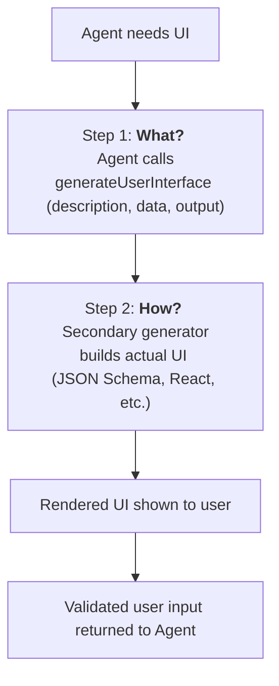

<em class="lead">无需自定义工具渲染器的 AI 生成界面</em>

# 生成式用户界面 {#generative-user-interfaces}

## 摘要 {#summary}

### 问题陈述 {#problem-statement}

目前，为智能体交互创建自定义用户界面需要程序员定义特定的工具渲染器。这限制了智能体驱动型应用的灵活性与适应性。

### 动机 {#motivation}

本提案描述了一个 AG-UI 扩展，用于解决**生成式用户界面**的问题——即由人工智能直接产出界面，而无需程序员定义自定义工具渲染器。核心思路是利用我们把客户端侧工具发送给智能体的能力，从而在 AG-UI 支持的所有智能体框架上启用这一能力。

## 状态 {#status}

- **状态**：草案
- **作者**：Markus Ecker (mail@mme.xyz)

## 挑战与限制 {#challenges-and-limitations}

### 工具描述长度 {#tool-description-length}

OpenAI 对工具描述强制执行 1024 个字符的限制。Gemini 和 Anthropic 没有此类限制。

### 参数 JSON Schema 约束 {#arguments-json-schema-constraints}

类、嵌套、`$ref` 和 `oneOf` 在各 LLM 提供商之间无法得到可靠支持。

### 上下文窗口考量 {#context-window-considerations}

把一种庞大的 UI 描述语言注入智能体可能会降低其性能。专门用于 UI 生成的智能体比同时承担 UI 生成与其他任务的智能体表现更好。

## 详细规范 {#detailed-specification}

### 两步生成流程 {#twostep-generation-process}



### 第 1 步：生成什么？ {#step-1-what-to-generate}

向智能体注入一个轻量工具：

**工具定义：**

- **名称：** `generateUserInterface`
- **参数：**
  - **description**：对 UI 的高层描述（例如 _"用于输入用户地址的表单"_）
  - **data**：为生成的 UI 提供的任意预填充数据
  - **output**：对智能体期望用户回传的数据的描述或 schema（字段、必填/可选、类型、约束）

**工具调用示例：**

```json
{
  "tool": "generateUserInterface",
  "arguments": {
    "description": "A form that collects a user's shipping address.",
    "data": {
      "firstName": "Ada",
      "lastName": "Lovelace",
      "city": "London"
    },
    "output": {
      "type": "object",
      "required": [
        "firstName",
        "lastName",
        "street",
        "city",
        "postalCode",
        "country"
      ],
      "properties": {
        "firstName": { "type": "string", "title": "First Name" },
        "lastName": { "type": "string", "title": "Last Name" },
        "street": { "type": "string", "title": "Street Address" },
        "city": { "type": "string", "title": "City" },
        "postalCode": { "type": "string", "title": "Postal Code" },
        "country": {
          "type": "string",
          "title": "Country",
          "enum": ["GB", "US", "DE", "AT"]
        }
      }
    }
  }
}
```

### 第 2 步：如何生成？ {#step-2-how-to-generate}

把 UI 生成委托给一个次级 LLM 或智能体：

- CopilotKit 用户始终掌握控制权：可以自建生成器、添加自定义库、加入额外提示词等。
- 在工具被调用时，次级模型消费 `description`、`data` 和 `output` 来生成用户界面
- 该模型只专注于 UI 生成，从而确保最高的保真度和一致性
- 生成方式可按需替换（例如 JSON、HTML 或其他可渲染格式）
- UI 格式描述不受结构或长度约束，允许任意复杂的规范

## 实现示例 {#implementation-examples}

### 示例输出：UISchemaGenerator {#example-output-uischemagenerator}

```json
{
  "jsonSchema": {
    "title": "Shipping Address",
    "type": "object",
    "required": [
      "firstName",
      "lastName",
      "street",
      "city",
      "postalCode",
      "country"
    ],
    "properties": {
      "firstName": { "type": "string", "title": "First name" },
      "lastName": { "type": "string", "title": "Last name" },
      "street": { "type": "string", "title": "Street address" },
      "city": { "type": "string", "title": "City" },
      "postalCode": { "type": "string", "title": "Postal code" },
      "country": {
        "type": "string",
        "title": "Country",
        "enum": ["GB", "US", "DE", "AT"]
      }
    }
  },
  "uiSchema": {
    "type": "VerticalLayout",
    "elements": [
      {
        "type": "Group",
        "label": "Personal Information",
        "elements": [
          { "type": "Control", "scope": "#/properties/firstName" },
          { "type": "Control", "scope": "#/properties/lastName" }
        ]
      },
      {
        "type": "Group",
        "label": "Address",
        "elements": [
          { "type": "Control", "scope": "#/properties/street" },
          { "type": "Control", "scope": "#/properties/city" },
          { "type": "Control", "scope": "#/properties/postalCode" },
          { "type": "Control", "scope": "#/properties/country" }
        ]
      }
    ]
  },
  "initialData": {
    "firstName": "Ada",
    "lastName": "Lovelace",
    "city": "London",
    "country": "GB"
  }
}
```

### 示例输出：ReactFormHookGenerator {#example-output-reactformhookgenerator}

```tsx
import React from "react"
import { useForm } from "react-hook-form"
import { z } from "zod"
import { zodResolver } from "@hookform/resolvers/zod"

// ----- Schema (contract) -----
const AddressSchema = z.object({
  firstName: z.string().min(1, "Required"),
  lastName: z.string().min(1, "Required"),
  street: z.string().min(1, "Required"),
  city: z.string().min(1, "Required"),
  postalCode: z.string().regex(/^[A-Za-z0-9\\-\\s]{3,10}$/, "3–10 chars"),
  country: z.enum(["GB", "US", "DE", "AT", "FR", "IT", "ES"]),
})
export type Address = z.infer<typeof AddressSchema>

type Props = {
  initialData?: Partial<Address>
  meta?: { title?: string; submitLabel?: string }
  respond: (data: Address) => void // <-- called on successful submit
}

const COUNTRIES: Address["country"][] = [
  "GB",
  "US",
  "DE",
  "AT",
  "FR",
  "IT",
  "ES",
]

export default function AddressForm({ initialData, meta, respond }: Props) {
  const {
    register,
    handleSubmit,
    formState: { errors },
  } = useForm<Address>({
    resolver: zodResolver(AddressSchema),
    defaultValues: {
      firstName: "",
      lastName: "",
      street: "",
      city: "",
      postalCode: "",
      country: "GB",
      ...initialData,
    },
  })

  const onSubmit = (data: Address) => {
    // Guaranteed to match AddressSchema
    respond(data)
  }

  return (
    <form onSubmit={handleSubmit(onSubmit)}>
      {meta?.title && <h2>{meta.title}</h2>}

      {/* Section: Personal Information */}
      <fieldset>
        <legend>Personal Information</legend>

        

        

      </fieldset>

      {/* Section: Address */}
      <fieldset>
        <legend>Address</legend>

        

        

        

        

      </fieldset>

      

    </form>
  )
}
```

## 实现考量 {#implementation-considerations}

### 客户端 SDK 变更 {#client-sdk-changes}

TypeScript SDK 新增内容：

- 新的 `generateUserInterface` 工具类型
- 用于可插拔生成器的 UI 生成器注册表
- 针对生成的 UI schema 的校验层
- 针对用户提交数据的响应处理器

Python SDK 新增内容：

- 对 UI 生成工具调用的支持
- Schema 校验工具
- UI 定义的序列化

### 集成影响 {#integration-impact}

- 所有 AG-UI 集成无需修改即可利用这一能力
- 框架发出标准的工具调用；客户端负责处理 UI 生成
- 与现有的基于工具的 UI 方案向后兼容

## 用例 {#use-cases}

### 动态表单 {#dynamic-forms}

智能体可以基于对话上下文即时生成表单，而无需预定义 schema。

### 数据可视化 {#data-visualization}

生成适合所讨论数据的图表、图形或表格。

### 交互式工作流 {#interactive-workflows}

创建契合用户需求的多步骤向导或引导式流程。

### 自适应界面 {#adaptive-interfaces}

根据用户偏好或设备能力生成不同的 UI 布局。

## 测试策略 {#testing-strategy}

- 针对工具注入与调用的单元测试
- 使用多个 UI 生成器的集成测试
- 演示各类 UI 的端到端测试
- 比较单步与两步生成的性能基准
- 跨提供商兼容性测试

## 参考 {#references}

- [AG-UI 工具文档](../concepts/tools.md)
- [JSON Schema](https://json-schema.org/)
- [React Hook Form](https://react-hook-form.com/)
- [JSON Forms](https://jsonforms.io/)
