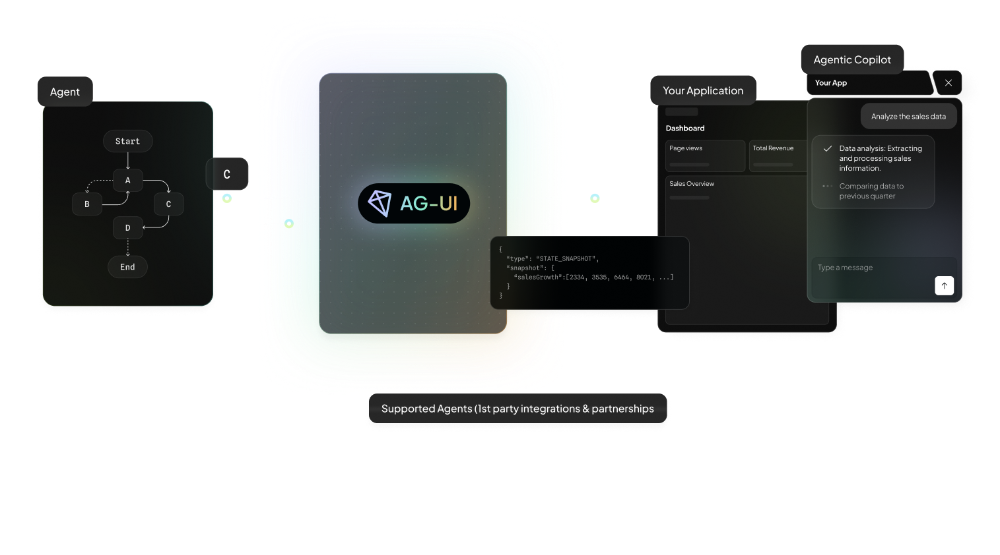

# 智能体–用户交互（AG-UI）协议 {#the-agentuser-interaction-agui-protocol}

AG-UI 是一个 <u><strong>开放</strong></u>、<u><strong>轻量</strong></u>、<u><strong>基于事件</strong></u>的协议，标准化了 AI 智能体与面向用户的应用之间的连接方式。

AG-UI 旨在成为面向用户的应用与任意智能体后端之间的通用双向连接。

AG-UI 以简洁和灵活为设计目标，标准化了智能体状态、UI 意图与用户交互在模型/智能体运行时与面向用户的前端应用之间的流转方式—让应用开发者能够快速交付可靠、可调试、对用户友好的智能体功能，同时专注于应用自身的需求，避免复杂的临时拼装式接线。

---

## 智能体协议 {#agentic-protocols}

!!! note
    <strong>对 “A2UI” 和 “AG-UI” 感到困惑？</strong>  这完全可以理解！尽管名称相似，二者其实相当不同，并且能很好地协同工作。A2UI 是一种[生成式 UI 规范](./concepts/generative-ui-specs.md) - 让智能体交付 UI 组件；而 AG-UI 是智能体↔用户交互协议 - 将智能体前端连接到任意智能体后端。[了解更多](https://copilotkit.ai/ag-ui-and-a2ui)

AG-UI 是三种主要的开放[智能体协议](./agentic-protocols.md)之一。

| **层** | **协议 / 示例** | **用途** |
| --- | --- | --- |
| **智能体 ↔ 用户交互** | **AG-UI （智能体–用户交互协议）** | 开放、基于事件的标准，将智能体连接到面向用户的应用 — 实现实时、多模态、交互式体验。 |
| **智能体 ↔ 工具与数据** | **MCP  （Model Context Protocol）** | 开放标准（由 Anthropic 发起），让智能体安全地连接到外部系统 — 工具、工作流和数据源。 |
| **智能体 ↔ 智能体** | **A2A （Agent to Agent）** | 开放标准（由 Google 发起），定义智能体如何在分布式智能体系统之间协调与共享工作。 |

---

## 构建模块（当前与即将推出） {#building-blocks-today--upcoming}

---

## 为什么智能体应用需要 AG-UI {#why-agentic-apps-need-agui}

智能体应用打破了智能体时代之前主导前后端开发的简单请求/响应模型：客户端发起请求，服务器返回数据，客户端渲染数据，交互随即结束。

#### 面向用户的智能体的需求 {#the-requirements-of-userfacing-agents}

尽管智能体本质上只是软件，但它们表现出一些特性，使其难以通过传统的 REST/GraphQL API 提供服务：

- 智能体**长时间运行**并**流式**输出中间工作—往往跨越多个轮次的会话。
- 智能体是**非确定性的**，并且可以**以非确定性的方式控制应用 UI**。
- 智能体同时混合**结构化与非结构化 IO**（例如文本与语音，以及工具调用和状态更新）。
- 智能体需要与用户交互的**组合能力**：例如它们可能调用子智能体，且常常是递归调用。
- 以及更多……

AG-UI 是一种基于事件的协议，支持智能体前端与后端之间的动态通信。它构建在 Web 的基础协议（HTTP、WebSockets）之上，作为为智能体时代设计的抽象层—弥合传统客户端-服务器架构与 AI 智能体动态、有状态特性之间的差距。

---

## AG-UI 实战 {#agui-in-action}

<video controls preload="metadata">
<source src="assets/videos/Dojo-overview.mp4" type="video/mp4">
</video>

!!! info
    你可以在 [AG-UI Dojo](https://dojo.ag-ui.com/) 中，用自己选择的框架查看 AG-UI 功能的演示应用，其中包含预览、代码与讲解文档。

---

## 支持的集成 {#supported-integrations}

AG-UI 源自 CopilotKit 与 LangChain、CrewAI 最初的**合作关系** - 并将这一广受欢迎的智能体-用户交互基础设施带给了更广泛的智能体生态。

**第一方** = 内置 AG-UI 并提供指导文档的平台。

### Direct to LLM {#direct-to-llm}

| 框架 | 状态 | AG-UI 资源 |
| :-------- | ------ | --------------- |
| Direct to LLM | 已支持 | [文档](https://docs.copilotkit.ai/direct-to-llm) |

### 智能体框架 - 合作伙伴 {#agent-framework--partnerships}
| 框架 | 状态 | AG-UI 资源 |
| :-------- | ------ | --------------- |
| [LangChain](https://www.langchain.com/langgraph) | 已支持 | [文档](https://docs.copilotkit.ai/langgraph/)、[演示](https://dojo.ag-ui.com/langgraph-fastapi/feature/shared_state) |
| [CrewAI](https://crewai.com/) | 已支持 | [文档](https://docs.copilotkit.ai/crewai-flows)、[演示](https://dojo.ag-ui.com/crewai/feature/shared_state) |

### 智能体框架 - 第一方 {#agent-framework--1st-party}
| 框架 | 状态 | AG-UI 资源 |
| :-------- | ------ | --------------- |
| [Microsoft Agent Framework](https://azure.microsoft.com/en-us/blog/introducing-microsoft-agent-framework/) | 已支持 | [文档](https://docs.copilotkit.ai/microsoft-agent-framework)、[演示](https://dojo.ag-ui.com/microsoft-agent-framework-dotnet/feature/shared_state) |
| [Google ADK](https://google.github.io/adk-docs/get-started/) | 已支持 | [文档](https://docs.copilotkit.ai/adk)、[演示](https://dojo.ag-ui.com/adk-middleware/feature/shared_state?openCopilot=true) |
| [Google ADK (JavaScript)](https://adk.dev/get-started/typescript/) | 已支持 | [快速开始](./integrations/google-adk-js.md)、[演示](https://dojo.ag-ui.com/adk-js/feature/agentic_chat?openCopilot=true) |
| [Google Antigravity](https://github.com/google-antigravity/antigravity-sdk-python) | 已支持 | [文档](https://docs.copilotkit.ai/google-antigravity)、[演示](https://dojo.ag-ui.com/antigravity/feature/shared_state) |
| [AWS Strands Agents](https://github.com/strands-agents/sdk-python) | 已支持 | [文档](https://docs.copilotkit.ai/aws-strands)、[演示](https://dojo.ag-ui.com/aws-strands/feature/shared_state) |
| [AWS Bedrock AgentCore](https://docs.aws.amazon.com/bedrock-agentcore/latest/devguide/runtime-agui-protocol-contract.html) | 已支持 | [文档](https://github.com/awslabs/fullstack-solution-template-for-agentcore) |
| [Mastra](https://mastra.ai/) | 已支持 | [文档](https://docs.copilotkit.ai/mastra/)、[演示](https://dojo.ag-ui.com/mastra/feature/tool_based_generative_ui) |
| [Pydantic AI](https://github.com/pydantic/pydantic-ai) | 已支持 | [文档](https://docs.copilotkit.ai/pydantic-ai/)、[演示](https://dojo.ag-ui.com/pydantic-ai/feature/shared_state) |
| [Agno](https://github.com/agno-agi/agno) | 已支持 | [文档](https://docs.copilotkit.ai/agno/)、[演示](https://dojo.ag-ui.com/agno/feature/tool_based_generative_ui) |
| [LlamaIndex](https://github.com/run-llama/llama_index) | 已支持 | [文档](https://docs.copilotkit.ai/llamaindex/)、[演示](https://dojo.ag-ui.com/llamaindex/feature/shared_state) |
| [AG2](https://ag2.ai/) | 已支持 | [文档](https://docs.copilotkit.ai/ag2/) [演示](https://dojo.ag-ui.com/ag2/feature/shared_state) |
| [AWS Bedrock Agents](https://aws.amazon.com/bedrock/agents/) | 进行中 | – |

### 智能体框架 - 社区 {#agent-framework--community}
| 框架 | 状态 | AG-UI 资源 |
| :-------- | ------ | --------------- |
| [Claude Agent SDK](https://github.com/ag-ui-protocol/ag-ui/tree/main/integrations/claude-agent-sdk) | 已支持 | [演示](https://dojo.ag-ui.com/claude-agent-sdk-python/feature/shared_state) |
| [Claude Managed Agents SDK](https://platform.claude.com/docs/en/managed-agents/overview) | 已支持 | [集成](https://github.com/ag-ui-protocol/ag-ui/tree/main/integrations/claude-managed-agents)、[演示](https://dojo.ag-ui.com/claude-managed-agents-python/feature/tool_based_generative_ui) |
| [Langroid](https://github.com/ag-ui-protocol/ag-ui/tree/main/integrations/langroid) | 已支持 | [演示](https://dojo.ag-ui.com/langroid/feature/shared_state) |
| [OpenAI Agent SDK](https://openai.github.io/openai-agents-python/) | 进行中 | – |
| [Cloudflare Agents](https://developers.cloudflare.com/agents/) | 已支持 | [集成](https://github.com/ag-ui-protocol/ag-ui/tree/main/integrations/community/cloudflare-agents) |

### 智能体交互协议 {#agent-interaction-protocols}

| 协议 | 状态 | AG-UI 资源 | 集成 |
| :------- | ------ | --------------- | ------------ |
| [A2A Middleware](https://a2a-protocol.org/) | 已支持 | [文档](https://docs.copilotkit.ai/a2a-protocol) | 合作伙伴 |

### 基础设施 / 部署 {#infrastructure--deployment}
| 平台 | 状态 | AG-UI 资源 | 集成 |
| :------- | ------ | --------------- | ------------ |
| [Amazon Bedrock AgentCore](https://aws.amazon.com/bedrock/agentcore/) | 已支持 | [文档](https://docs.aws.amazon.com/bedrock-agentcore/latest/devguide/runtime-agui.html) | 第一方 |

### 规范（标准） {#specification-standard}
| 框架 | 状态 | AG-UI 资源 |
| :-------- | ------ | --------------- |
| [Oracle Agent Spec](http://oracle.github.io/agent-spec/) | 已支持 | [文档](https://go.copilotkit.ai/copilotkit-oracle-docs)、[演示](https://dojo.ag-ui.com/agent-spec-langgraph/feature/tool_based_generative_ui) |

### 生成式 UI {#generative-ui}
| 框架 | 状态 | AG-UI 资源 |
| :-------- | ------ | --------------- |
| [A2UI](https://github.com/google/A2UI) | 已支持 | [文档](./concepts/generative-ui-specs.md) |
| [MCP Apps](https://blog.modelcontextprotocol.io/posts/2025-11-21-mcp-apps/) | 已支持 | [文档](https://docs.copilotkit.ai/generative-ui-specs/mcp-apps) |

### SDKs {#sdks}

| SDK | 状态 | AG-UI 资源 | 集成 |
| :-- | ------- | ---------------- | ------------- |
| [Kotlin]() | 已支持 | [入门](https://github.com/ag-ui-protocol/ag-ui/blob/main/docs/sdk/kotlin/overview.mdx) | 社区 |
| [Golang]() | 已支持 | [入门](https://github.com/ag-ui-protocol/ag-ui/blob/main/docs/sdk/go/overview.mdx) | 社区 |
| [Dart]() | 已支持 | [入门](https://github.com/ag-ui-protocol/ag-ui/tree/main/sdks/community/dart) | 社区 |
| [Java]() | 已支持 | [入门](https://github.com/ag-ui-protocol/ag-ui/blob/main/docs/sdk/java/overview.mdx) | 社区 |
| [Rust]() | 已支持 | [入门](https://github.com/ag-ui-protocol/ag-ui/tree/main/sdks/community/rust/crates/ag-ui-client) | 社区 |
| [Ruby]() | 已支持 | [入门](https://github.com/ag-ui-protocol/ag-ui/tree/main/sdks/community/ruby) | 社区 |
| [C++]() | 已支持 | [GitHub 源码](https://github.com/ag-ui-protocol/ag-ui/tree/main/sdks/community/c%2B%2B) | 社区 |
| [.NET]() | 已支持 | [入门](https://github.com/ag-ui-protocol/ag-ui/tree/main/sdks/dotnet/samples/GettingStarted) | 社区 |
| [Nim]() | 进行中 | [PR](https://github.com/ag-ui-protocol/ag-ui/pull/29) | 社区 |
| [Flowise]() | 进行中 | [GitHub 源码](https://github.com/ag-ui-protocol/ag-ui/issues/367) | 社区 |
| [Langflow]() | 进行中 | [GitHub 源码](https://github.com/ag-ui-protocol/ag-ui/issues/366) | 社区 |

### 客户端 {#clients}

| 客户端 | 状态 | AG-UI 资源 | 集成 |
| :----- | ------ | --------------- | ------------ |
| [CopilotKit](https://github.com/CopilotKit/CopilotKit) | 已支持 | [入门](https://docs.copilotkit.ai/direct-to-llm/guides/quickstart) | 第一方 |
| [Terminal + Agent]() | 已支持 | [入门](./quickstart/clients.md) | 社区 |
| 聊天平台（Slack、Microsoft Teams） | 已支持 | [Channels SDK](https://github.com/CopilotKit/channels-sdk)、[OpenTag 示例](https://github.com/CopilotKit/OpenTag) | 第一方 |
| [React Native](https://reactnative.dev/) | 已支持 | [示例](https://github.com/CopilotKit/CopilotKit/tree/main/examples/v2/react-native/demo) | 第一方 |

AG-UI 客户端不必是 Web 应用。该协议描述的是事件流，而非渲染目标，因此终端、移动应用或聊天平台都可以充当客户端。

聊天平台客户端是任何人都可以基于 AG-UI 构建的东西。[Channels SDK](https://github.com/CopilotKit/channels-sdk) 是它的一种实现，而 [OpenTag](https://github.com/CopilotKit/OpenTag) 是构建在其之上的一个完整应用：一个通过 AG-UI 提供服务的 Python LangGraph 智能体，接入 Slack 和 Microsoft Teams。在该应用中，智能体及其运行时为自托管，而平台凭据与消息投递由 CopilotKit Intelligence 处理 — 这是一项托管服务，不属于协议的一部分。

---

## 快速开始 {#quick-start}

选择适合你需求的路径：

- [构建智能体应用](./quickstart/applications.md) — 构建由 AG-UI 兼容智能体驱动的智能体应用。

  - [构建新的 AG-UI 集成](./quickstart/introduction.md) — 为新的智能体框架、自定义内部解决方案构建集成，或在不使用任何智能体框架的情况下使用 AG-UI。

  - [构建 AG-UI 兼容客户端](./quickstart/clients.md) — 为 AG-UI 兼容智能体构建新的客户端（Web、移动端、Slack、消息平台等）

## 探索 AG-UI {#explore-agui}

深入了解 AG-UI 的核心概念与能力：

- [核心架构](./concepts/architecture.md) — 理解 AG-UI 如何连接智能体、协议与前端

  - [事件](./concepts/events.md) — 了解 AG-UI 的事件驱动协议

## 资源 {#resources}

浏览这些指南、工具与集成，帮助你构建、优化和扩展你的 AG-UI 实现。这些资源涵盖从实际开发工作流到调试技巧的方方面面。

- [使用 Cursor 开发](./tutorials/cursor.md) — 使用 Cursor 更快地构建 AG-UI 实现

  - [排查 AG-UI 问题](./tutorials/debugging.md) — 修复使用 AG-UI 服务器和客户端时的常见问题

## 贡献 {#contributing}

想要参与贡献？请查看我们的[贡献指南](./development/contributing.md)，了解如何帮助改进 AG-UI。

## 支持与反馈 {#support-and-feedback}

以下是获取帮助或提供反馈的方式：

- 与 AG-UI 规范、SDK 或文档（开源）相关的 bug 报告和功能请求，请[创建 GitHub issue](https://github.com/ag-ui-protocol/ag-ui/issues)
- 关于 AG-UI 的讨论或问答，请加入 [Discord 社区](https://discord.gg/Jd3FzfdJa8)
- 生产环境架构或实现方面的帮助，请参阅[生产支持](./talk-to-us.md)
